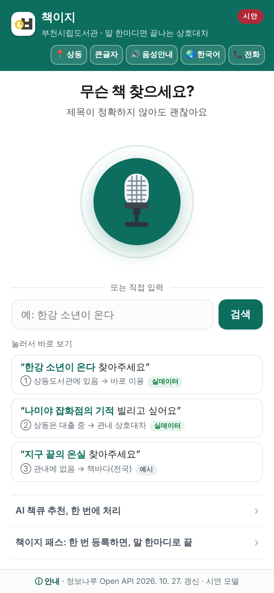
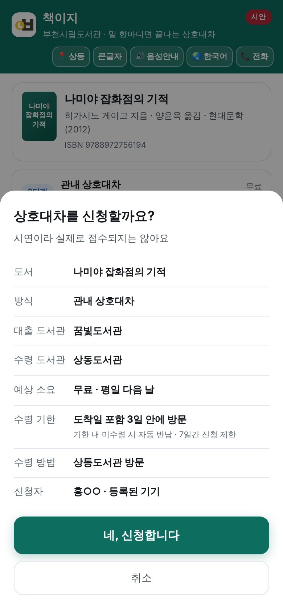

# 책이지 — 말 한마디로 내 손안에 책이

**도서관 상호대차 절차를 대신하는 AI 에이전트** — 창구·전화에서 사서가 **지금 쓰는** 상담 비서(판정 도구)와, 시민이 직접 쓰는 음성 화면(시범 운영 제안)

  
  
  
  
  

> "그 책 있어요? 여기로 가져다줄 수 있어요?" — 도서관 창구와 전화에서 하루에도 여러 번 되풀이되는 질문입니다. 책이지는 그 말 한마디로 **어떤 책인지 찾고, 16개 도서관의 소장·대출 상태를 확인하고, 상호대차가 되는지 규정으로 판정해, 이용자에게 읽어 줄 안내문까지** 만듭니다. "책이 이지(easy)"라는 뜻입니다.
> 이 저장소 하나에 두 가지가 있습니다. **지금 쓸 수 있는 것** — 사서용 상담 비서(MCP 참조 서버, `server/`). **시범 운영 제안** — 시민이 직접 말해서 신청까지 끝내는 음성 화면(시연 웹, 루트).

| | 지금 쓸 수 있는 것 — 상담 비서 | 시범 운영 제안 — 시민 음성 화면 |
|---|---|---|
| 누가 | 창구·전화 상담 사서 | 시민(어르신·외국인 주민·시각이 불편한 분 포함) |
| 무엇을 | 말 한마디 → 책 특정 → 소장·대출 상태 → 상호대차 가능 여부·갈래 판정 → 안내문·접수 메모 | 같은 도구를 음성·10개 언어·큰글자·전화 모드로, 신청 확인까지 |
| 어디까지 진짜인가 | **판정·안내문까지 진짜**(정보나루 데이터). 접수는 사서가 현행 시스템에서 | 화면·음성·판정 흐름은 진짜. **접수는 시연**(실제로 들어가지 않음) |
| 어떻게 돌리나 | **설치 없이:** claude.ai 커스텀 커넥터에 주소 한 줄(원격 상담 비서) · **설치형:** `server\run.bat` → 클로드 데스크톱 또는 로컬 공개 모델(Ollama) → 프롬프트 `consult` | https://altarry-prog.github.io/chaekiji/ 를 휴대폰으로 |

  
  
  

왼쪽부터: 첫 화면 → 「나미야 잡화점의 기적 빌리고 싶어요」의 판정 결과 → 신청 확인 시트 (2026. 10. 13. 화면)

## 1분 시연 영상

▶ 클릭하면 영상(mp4, 3MB)이 재생됩니다 · 자막만 있는 무음 영상 · 시민 음성 화면(시연 웹)을 실제로 조작해 녹화(2026. 10. 14.) · 상담 비서 실연 영상은 준비 중

움직이는 미리보기(GIF, 1.9MB)

> ⚠️ **정직 고지.** 부천시립도서관이 공식 제공하는 서비스가 아니라, 담당 사서가 직접 만들어 검증 중인 도구입니다. 상담 비서의 판정·안내문은 정보나루 공개 데이터로 실제 동작하지만 **접수는 하지 않습니다**(창구에서 사서가). 시민 음성 화면의 신청 흐름은 화면 안에서 완결되며 **실제 상호대차 접수로 이어지지 않습니다.** 대출 상태는 조회일 **전일 기준**입니다.

| 구성 | 판 | 상태 | 라이선스 |
|---|---|---|---|
| 참조 서버 (`server/`) — 상담 비서 | **v0.3.5** (2026. 10. 16.) | 표준 도구 10종 + 상담 묶음 1 · 규정 7종 · **시험 83건 통과** · Python 3.9+ · 모델 비종속(MCP, 호스트 2종) · 중계로 키 없이 오늘 데이터 | MIT |
| 시연 웹 (루트) — 시민 음성 화면 | **v1.12.2** (2026. 10. 16.) · 캐시 v28 | 10개 언어 음성 · 큰글자 · 전화 모드 · 설치형 웹 · 자동 시험 66+17건 통과(9/19) · 매일 갱신 파일(없으면 중계)로 어제 기준 데이터 | 제작자 권리 유보(아래 안내) |
| 중계 (`relay/`) | **2026. 10. 16. 배포** | 정보나루 인증키를 서버 쪽에만 두는 얇은 층 — Cloudflare Workers(무료, 깃허브 액션이 배포·확인 기록 `relay/last_deploy.json`)·파이썬 판, 점검 19건(https 안 되면 http로 넘어가기·정보나루 오류 문구를 「없음」으로 바꾸지 않기 포함) | — |
| 데이터 | 정보나루 Open API 2026. 8. 18. 실측 64건 | 부천 16개관 × 도서 4종 전수 | — |
| 만든 곳 | 부천시립도서관 상동도서관 | 행정안전부 「AI 정부 실험실」 등록 과제(2026. 8. 31.) | — |

## 60초 요약

- **문제.** 창구와 전화에서는 사서가 매번 도서관리시스템 조회와 규정 확인을 머릿속으로 합니다. 시민 쪽에서는 홈페이지 로그인부터 신청까지 화면 아홉 번이고, 한도·수령관 비치·연체·제외 자료 같은 규정은 이용자가 맞춰야 하며, 어르신·시각장애인·다문화 주민은 그 앞에서 멈춥니다.
- **해법.** 말 한마디를 모델이 알아듣고, 조회·판정은 **규칙으로 짜인 도구**가 합니다. 모델은 도구를 고르고 안내문을 다듬는 일만 하므로 모델을 바꿔도 결과가 같고 비용이 거의 들지 않습니다.
- **지금 쓸 수 있는 것.** 사서용 **상담 비서** — 클로드 데스크톱이든 사무용 PC의 공개 모델(엑사원·라마)이든 같은 서버·같은 지시문으로 돌아갑니다. 접수는 사서가 합니다.
- **시범 운영 제안.** 같은 도구를 시민이 직접 쓰는 음성 화면. 접수까지 자동으로 하려면 도서관리시스템 연동(커넥터 7함수)이 필요하고, 그 명세가 이 저장소에 있습니다.
- **증명하는 것.** 어느 도서관·어느 모델에서도 같은 **도구 계약**. 다른 도시는 설정 파일 하나, 다른 모델은 호스트 설정만 바꾸면 됩니다.

## 바로 보기 — 설치 없이 (0단계)

| 화면 | 주소 |
|---|---|
| 📱 시연 웹 | https://altarry-prog.github.io/chaekiji/ |
| 🔌 MCP 확산 모델 설계도 | https://altarry-prog.github.io/chaekiji/mcp.html |
| 🕹️ MCP 도구 호출 콘솔 | https://altarry-prog.github.io/chaekiji/console.html |
| 🧑‍💼 상담 비서(원격 · claude.ai 커넥터) | `https://chaekiji-relay.altarry2.workers.dev/mcp` — 아래 「설치 없이」 |

휴대폰 크롬·사파리에서 열고 마이크를 허용하면 됩니다(PC에서는 위 1분 영상이 같은 흐름입니다). 첫 화면의 「눌러서 시작하기」를 누르면 음성 안내가 시작되고, 예시 세 개를 누르면 세 갈래(우리 관 소장 → 바로 이용 / 관내 다른 관 → 상호대차 / 관내에 없음 → 책바다 안내)를 바로 볼 수 있습니다.

## 바로 돌려보기 — 상담 비서 (10분)

0. **설치 없이(1분) — 인터넷 창의 claude.ai에서.** 「사용자 지정 → 커넥터 → 커스텀 커넥터 추가」에 아래 주소를 넣습니다(로그인 없음 · 무료 요금제는 1개까지). 새 대화의 「+ → 커넥터」에서 켜고 이용자의 말을 그대로 적으면 됩니다.

       https://chaekiji-relay.altarry2.workers.dev/mcp

   원격 판은 **읽기·판정만**(도구 3종: `consult_request` · `search_item` · `check_availability`) — 접수·회원 토큰은 받지 않습니다. 파이썬 판과 같은 입력에 같은 판정·안내문을 내는지 자동 대조합니다(16건). 정보나루 데이터는 오늘 새벽 매일 갱신 자료, 없으면 그 자리 조회(전일 기준). 자세히: [relay/README.md](relay/README.md#원격-상담-비서-mcp--claudeai-커넥터)

1. **준비·시험(2분)** — 처음 받은 PC에서 이것 하나면 됩니다(네트워크·인증키·Ollama 불필요):

       Windows:      server\run.bat
       macOS·Linux:  sh server/run.sh

   의존성 설치(PyYAML 하나) → 시험 83건(적합성 48 · 실험실 점검 14 · 중계 모드 15 · 공개 모델 호스트 6)을 돌리고 「준비 완료」를 찍습니다.

2. **클로드 데스크톱에서(3분)** — `server/claude_desktop_config.example.json`대로 서버를 등록(모드 `auto`)하고 재시작 → 「+」 메뉴에서 프롬프트 **consult**를 고르고 받을 도서관을 적은 뒤 이용자의 말을 넣습니다.

       나미야 잡화점의 기적 빌리고 싶어요, 상동에서 받을게요
       → consult_request 1회 → ① 판정 「관내 상호대차」 ② 이용자 안내문(조회일·전일 기준) ③ 접수 메모

3. **공개 모델에서도(3분)** — Ollama에 `exaone3.5:2.4b`(또는 `llama3.2:3b`)를 받고:

       python server/hosts/ollama_host.py --model exaone3.5:2.4b --ask "나미야 잡화점의 기적 빌리고 싶어요, 상동에서 받을게요"

   같은 도구가 호출되고 같은 판정이 나옵니다 — 모델 비종속. 설치 없이 하려면 **코랩 노트북**([열기](https://colab.research.google.com/github/altarry-prog/chaekiji/blob/main/server/lab/colab_model2.ipynb))에서 「모두 실행」 한 번 — 엑사원·라마 2종으로 같은 문의 5건을 처리하고 기록표를 만듭니다. 절차·기록표는 [server/docs/모델2종-구동.md](server/docs/모델2종-구동.md).

4. **시민 음성 화면(2분)** — 휴대폰으로 위 시연 웹 주소를 열어 같은 책을 말해 봅니다.

데이터는 기본 `auto`: 중계(10/16 배포)에 닿으면 **키 없이 오늘 데이터**(매일 갱신 스냅샷에 있는 책은 스냅샷), 닿지 않으면 매일 갱신 스냅샷(2일 이내) → 2026. 8. 18. 실측 픽스처. 어느 쪽인지 안내문에 날짜로 찍힙니다. 도구 10종의 계약, 실계(live) 모드, 다른 호스트(Codex CLI · VS Code) 연결은 [server/README.md](server/README.md).

## 구조 — 네 층

| 경로 | 무엇 |
|---|---|
| `index.html` · `sw.js` · `manifest.webmanifest` · 아이콘 | 시연 웹 — 화면·논리 전부 단일 파일, 설치형 웹(PWA) |
| `mcp.html` · `console.html` | 확산 모델 설계도 · 도구 호출 콘솔 (참조 서버 v0.3 기준) |
| `server/` | MCP 참조 서버 — `server.py`(전송·프롬프트) · `tools.py`(도구 10종 + 상담 묶음) · `policy.py`(규정 엔진) · `config/*.yaml`(도시별 설정) · `connectors/`(정보나루 demo/relay/live · 도서관리시스템 모의) · `hosts/`(공개 모델 호스트) · `tests/`·`lab/`(시험 83건) · `docs/`(설계·로드맵·모델 2종 구동) · `prompts/`(사서 모드 지시문·AI 지시문 기록) |
| `relay/` | 정보나루 중계 — `worker.js`(Cloudflare Workers, 무료 호스팅용) · `relay.py`(파이썬 표준 라이브러리, PC·VM용) · 경로 `/holdings` `/search` `/nation` `/health`, 키는 환경변수만. 시연 웹과 서버(relay 모드)가 함께 쓴다 |
| `data/` | 매일 갱신 조회분 `holdings-today.json`(깃허브 액션 `refresh.yml`이 씀) — 시연 웹이 중계 없을 때 읽는 파일 |
| `docs/` | README 사진·구조 그림 · [시연 웹 기능 상세와 판별 이력](docs/시연웹-기능-상세.md) · 시연 웹 변경내역 원문 |
| `CHANGELOG.md` | 웹·서버를 한 줄로 꿴 변경 기록 (서버 상세는 `server/CHANGELOG.md`) |

## 무엇이 진짜이고 무엇이 모의인가 (정직 고지)

| 구성요소 | 상태 |
|---|---|
| 상담 비서(`consult_request` · 프롬프트 `consult`) | **진짜** — 찾기·소장·대출·규정 판정·안내문·접수 메모까지. **접수는 하지 않음**(창구에서 사서가). 회원 한도·연체·중복은 토큰 없으면 창구 확인으로 보류. 안내문 끝의 공식 누리집 링크는 그 책의 검색 화면까지 — 신청은 이용자가 로그인해 직접 |
| 화면·음성·다국어·판정 흐름 | **진짜** — 브라우저에서 전부 동작 |
| MCP 서버(stdio JSON-RPC, 도구 10종 + 1) · 규정 엔진 · 설정 분리 · 신청 생애주기 | **진짜** — 표준 클라이언트 연결 가능, 시험 83건으로 검증 |
| 공개 모델 호스트(`server/hosts/ollama_host.py`) | **시험 구현** — 모의 Ollama로 두 방식 통과. 실제 모델(엑사원·라마) 실측 기록은 【10월 하순】 |
| 소장·대출 데이터 | 세 겹 — 깃허브 액션이 새벽마다 커밋하는 **매일 갱신 파일**(`data/holdings-today.json`)에 그 책이 있으면 그 파일, 없거나 묵었으면 **중계(relay)로 그 자리에서 조회**(10/16 배포 — 상담 비서가 목록에 없는 책을 물을 때), 그것도 안 되면 2일 이내 파일 → **2026. 8. 18. 실측값**(64건). 어느 쪽이든 대출 가능 여부는 **조회일 전일 기준**, 날짜가 화면·안내문에 찍힘 (인증키는 중계 서버·Secrets 환경변수에만) |
| 상호대차 신청 | **시연** — 실제 접수되지 않음. 도서관리시스템 커넥터는 **모의**이며, 그 함수 7개가 곧 벤더 연동 명세 |
| 책이지 패스(사전 위임) | **위임 흐름·범위 판정은 진짜, 위임장 보존·통지는 시연** |
| 전화 한 통 모드 | **대화 흐름은 진짜, 전화망은 시연** — 실제 전화는 걸리지 않음 |
| 등록된 기기(패스키) · 바코드 · 기기 내 음성 인식 · WebMCP | **지원 기기·브라우저에서만** — 패스키는 기기 안에서는 진짜, 서버 검증은 없음(기본 꺼짐) |
| 외국어 음성 인식 | **기기·브라우저의 인식 언어 범위에 달림** — 미지원 언어는 글자 입력으로 안내, 번역은 시연 웹이 하지 않음 |
| 회원 데이터 · 신착·비도서 제외·보관기한 값 | 가상 인물 · **예시 규정**(기관 확정 규정으로 교체하는 자리) |

항목별 긴 설명은 [docs/시연웹-기능-상세.md](docs/시연웹-기능-상세.md)와 [server/README.md](server/README.md)의 같은 절에 있습니다.

## 걸어온 길

| 시기 | 무엇이 생겼나 |
|---|---|
| 2026. 8. 9. | 상동도서관에서 과제 착수 — 상호대차 절차를 AI가 대신 한다는 구상, 정보나루 Open API 조사 |
| 8. 16. | 시연 웹 **v1.0** 첫 공개(깃허브 페이지스) — 음성 검색·3단계 탐색·규정 판정·신청 흐름, 10개 언어, PWA |
| 8. 18. | 정보나루 실측 64건(16개관 × 4종) — 화면의 소장·대출 데이터가 실측값이 됨 |
| 8. 24. | 도서관 AI 서비스 도입 TF 회의 시연 |
| 8. 28.~30. | 참조 서버 **v0.1 → v0.3** — 도구 6종·규정 엔진·설정 분리 → 책이지 패스 → 생애주기(추적·취소·한도 복원·멱등성), 적합성 시험 33건 |
| 8. 31. | 행정안전부 「AI 정부 실험실」 공공 GitLab 등록(저장소 2건) |
| 9. 4.~6. | 시연 웹 **v1.3** 전화 한 통 모드 · 지자체 5곳 규정 조사 → 서버 v0.4 로드맵 공개 |
| 9. 10.~15. | 시연 웹 **v1.5 → v1.6** — 자주 가는 도서관·바코드·패스키·네/아니오·WebMCP · **정직성 수정**(있는 도서관은 방문 안내, 패스는 사전 위임으로 재정의) |
| 9. 19. | 시연 웹 **v1.7** — 음성 인식 관리자, 자동 시험 66+17건 |
| 9. 23. | 실험실 가상서버 배정 · 공개 사본을 새 환경(우분투 24.04)에서 복제해 33건 재현 |
| 9. 27. | 참조 서버 **v0.3.1** 실험실 키트 — 정보나루 관내 조회원·SQLite 저장·해시 사슬 감사·실측 스크립트 |
| 10. 1.~2. | 시연 웹 **v1.8 → v1.9** — 언어별 음성 인식 지원 표시 · 음성 안내 시작 화면·낭독 안정화 |
| 10. 12. | 참조 서버 **v0.3.2** — 원커맨드 실행·CHANGELOG·모델 2종 구동 절차·정보나루 중계 설계 |
| 10. 13. | 참조 서버 **v0.3.3** README 개정 · **저장소 통합** — `chaekiji-mcp`를 `server/`로, 한 저장소·한 README·한 이력 |
| 10. 14. | 1분 시연 영상·GIF 미리보기 · README 전면 손질 · 시연 웹 **v1.10** + **정보나루 중계 `relay/`**(실데이터 연결, 자동 복귀) |
| 10. 16. | 참조 서버 **v0.3.5** — 정보나루 조회가 실패하고 8/18 실측 자료에도 없는 책은 「미소장」이 아니라 **「소장 확인 불가(창구에서 조회)」**로 답함(독립 검토에서 발견한 틀린 안내 수정) · 시험 83건 |
| 10. 16. | **중계 첫 배포**(Cloudflare Workers, 행정망에서 Cloudflare 화면이 막혀 깃허브 액션이 대신 올림) — 확인 기록상 나미야 잡화점의 기적 16관 조회가 같은 날 새벽 매일 갱신 자료와 개수가 같음(대출 가능 7·대출 중 6·미소장 3). 실패하면 까닭만 남기고, 정보나루 오류 문구를 「없음」으로 바꾸지 않게 보강. 시연 웹 **v1.12.2** 중계 연결(오늘 새벽 파일 먼저) · 캐시 v28 |
| 10. 16. | **매일 갱신 첫 실측**(깃허브 액션 → 정보나루) — 연결 거절·지연이 섞여 나와 다시 시도·https→http 넘어가기·실행 기록(키 가림)을 넣음. 같은 날 시연 웹 **v1.12.1**: 예시 단추는 8/18 장면 고정, 직접 찾으면 오늘 자료, ③은 「예시」로 표시(실제 조회에서 16개관 소장으로 확인) |
| 10. 16. | 시연 웹 **v1.12** 화면 정리 — 첫 화면 카드 2장을 글자 줄로, 도서관코드·기술 용어 행 숨김, 결과 화면에 「공식 누리집에서 이 책 보기 · 신청」 링크(10개 언어) · 캐시 v26 |
| 10. 16. | 상담 비서 안내문 끝에 **공식 누리집 링크**(설정 `official_search_url`) — 그 책의 자료검색 화면까지, 신청은 이용자가 직접. 시험 82건 |
| **10. 15.** | 참조 서버 **v0.3.4 「상담 비서」** — 사서가 지금 쓰는 판정 도구(`consult_request`·프롬프트 `consult`) · relay/auto 모드 · 공개 모델 호스트 · **매일 갱신**(깃허브 액션) · 시연 웹 v1.11(매일 갱신 파일 읽기) · 시험 80건 |

상세: [CHANGELOG.md](CHANGELOG.md) · [docs/시연웹-기능-상세.md](docs/시연웹-기능-상세.md) · [server/CHANGELOG.md](server/CHANGELOG.md)

## 다른 도시에 옮기면

상담 비서는 도서관 코드와 규정 숫자를 담은 `server/config/<도시>.yaml` 하나만 새로 쓰면 바로 씁니다(반나절) — 정보나루는 전국 공통 데이터이고 접수는 사람이 하기 때문입니다. 접수까지 자동으로 하려면 도서관리시스템이 같은 곳은 커넥터를 재사용하고, 다른 곳은 함수 7개짜리 커넥터를 한 번만 만들어 전국이 공유합니다. 즉 개발은 **도시 수만큼이 아니라 도서관리시스템 종류 수만큼**만 하면 됩니다. 모델을 바꿔도 도구·커넥터 층은 그대로이고, 화면도 바꿔 끼울 수 있습니다 — 창구 PC든 도서관 홈페이지든 키오스크든 같은 도구를 부르면 됩니다.

## 다음

- ~~매일 갱신 켜기~~ · ~~중계 올리기~~ — 10. 16. 완료(새벽 05:30 자동 커밋 · 중계 `https://chaekiji-relay.altarry2.workers.dev`). 남은 확인: 행정망 PC에서 중계 주소가 열리는지 — 막혀 있으면 그 PC의 상담 비서는 매일 갱신 스냅샷을 쓴다
- **모델 2종 실측** — 클로드 데스크톱 + 사무용 PC의 공개 모델(엑사원 3.5 2.4B 또는 라마 3.2 3B)에서 같은 상담 흐름을 돌려 `server/lab/out/`에 기록. 절차·기록표는 [server/docs/모델2종-구동.md](server/docs/모델2종-구동.md)
- **창구 체험** — 동료 사서가 문의 몇 건을 현행 방식과 상담 비서로 각각 처리해 걸린 시간을 재고(익명), 그 숫자를 여기에 적는다【10월 하순】
- **참조 서버 v0.4** — 예약 분기·책바다는 안내·미수령 제재·취소 시점·예상 수령일 계산 + **위임 범위 안 자동 재경로**, **기억의 경계**(설정과 위임장은 기억하되 무엇을 읽었는지는 기억하지 않음). 계획은 [server/docs/ROADMAP-v0.4.md](server/docs/ROADMAP-v0.4.md)

## 문서 지도 — 무엇을 보려면 어디로

| 알고 싶은 것 | 문서 |
|---|---|
| 화면이 실제로 어떻게 움직이나 | 위 1분 영상 · [시연 웹](https://altarry-prog.github.io/chaekiji/) |
| 시연 웹의 기능 하나하나와 판별 이력 | [docs/시연웹-기능-상세.md](docs/시연웹-기능-상세.md) |
| 상담 비서를 창구에서 쓰는 법(클로드·공개 모델) | [server/README.md](server/README.md) 「상담 비서」 절 · [server/prompts/상담비서-지시문.md](server/prompts/상담비서-지시문.md) |
| 참조 서버 설치·연결·도구 10종 계약 | [server/README.md](server/README.md) |
| 규정 엔진이 보는 규정 7종과 도시별 설정 | [server/config/](server/config/) · [server/docs/](server/docs/) |
| 다른 모델(클로드·공개 모델)에서 같은 서버 돌리기 | [server/docs/모델2종-구동.md](server/docs/모델2종-구동.md) |
| 실데이터를 붙이는 설계 | [server/docs/정보나루-중계-설계.md](server/docs/정보나루-중계-설계.md) |
| 다음 판 계획 | [server/docs/ROADMAP-v0.4.md](server/docs/ROADMAP-v0.4.md) |
| 무엇이 언제 바뀌었나 | [CHANGELOG.md](CHANGELOG.md) · [server/CHANGELOG.md](server/CHANGELOG.md) |

## 함께 보기

- 공공 GitLab(공식 등재처): https://gitlab.aigov.go.kr/altarry/chaekiji · 깃허브(시연 웹 호스팅): https://github.com/altarry-prog/chaekiji
- 종전 단독 저장소(2026. 10. 13. 통합, 보관): [chaekiji-mcp](https://gitlab.aigov.go.kr/altarry/chaekiji-mcp)
- 데이터 출처: 도서관 정보나루 Open API(국립중앙도서관) srchBooks · libSrchByBook · bookExist · loanItemSrch / 국립장애인도서관 대체자료종합목록(대체자료 분기 시연)
- 정보나루 공식 MCP(국립중앙도서관, 2026. 8. 개시)는 **조회** 도구입니다. 책이지는 그 위에 **판정·실행** 계층을 얹는 제안입니다.

---

## 저작권 및 이용 안내

© 2026 이완재 · 부천시립도서관 상동도서관

- **시연 웹(저장소 루트의 화면 파일)** — 실현가능성 검증용 시연 모델입니다. 코드·문서의 저작권은 제작자에게 있으며 별도의 이용 허락(라이선스)은 아직 정하지 않았습니다. 도입·인용·재사용을 검토하시는 기관은 아래로 문의해 주시기 바랍니다.
- **참조 서버(`server/`)** — 다른 도서관이 그대로 가져다 쓸 수 있도록 **MIT 라이선스**(`server/LICENSE`)로 공개합니다.

두 부분의 이용 조건이 다른 것은 성격의 차이에 따른 것입니다 — 참조 구현은 확산을 위해 열어 두고, 시연 모델은 제안 검증용으로 권리를 유지합니다.

문의: 부천시립도서관 상동도서관 이완재 (altarry@korea.kr)
2026. 8.~10. · 부천시립도서관 상동도서관 · 부천시립도서관 AI 서비스 도입 TF · 행정안전부 「AI 정부 실험실」 과제
