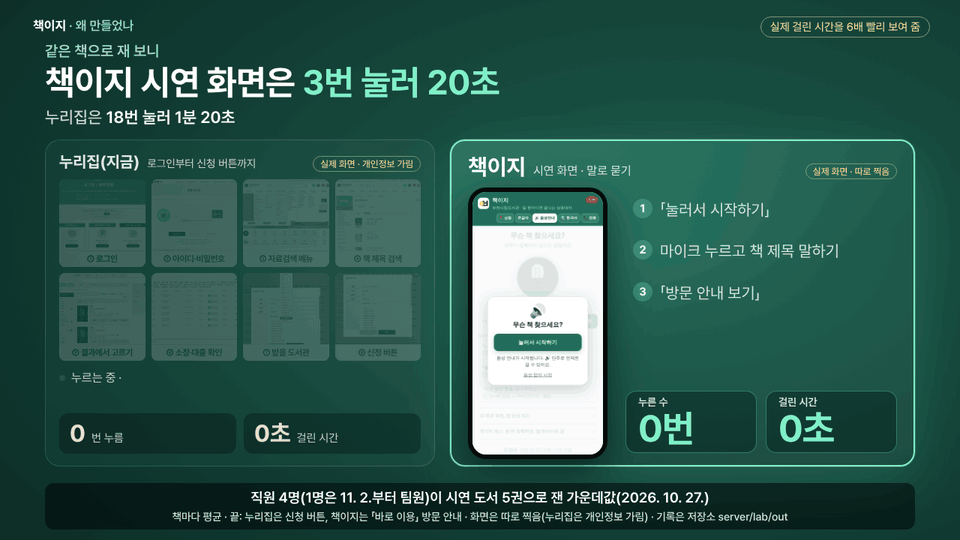
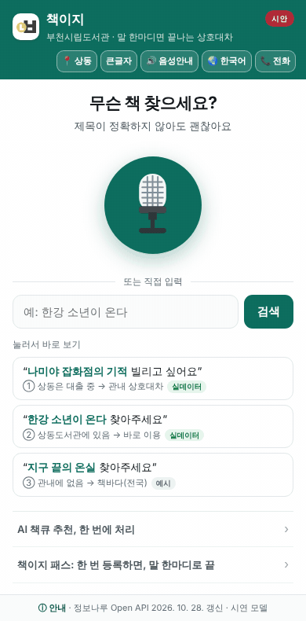
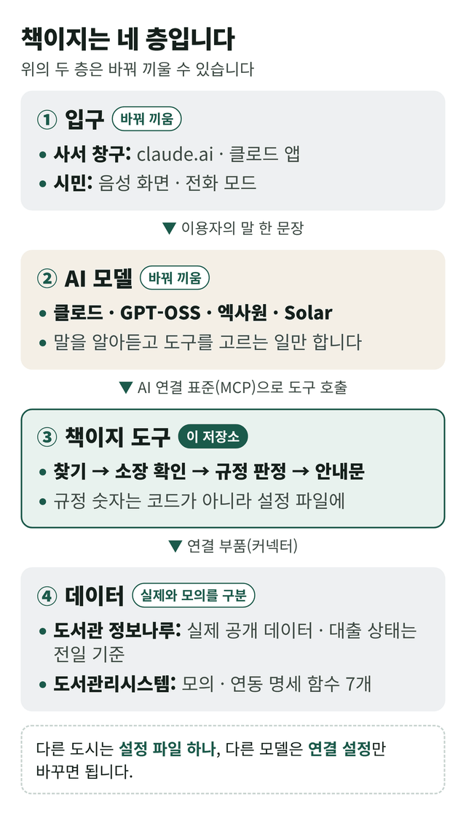

# 책이지: 말 한마디로 내 손안에 책이

**상호대차**는 가까운 도서관에 없거나 대출 중인 책을 다른 도서관에서 보내 받아, 
가까운 도서관에서 빌리고 반납하는 공공도서관 서비스입니다. 
부천시립도서관은 2025년 한 해 상호대차로 320,140권을 시민에게 제공했습니다.

> **「한강 소년이 온다, 역곡도서관에서 받을 수 있어요?」** (예시)
>
> 이렇게 물으면 책이지가 부천시립도서관 16곳에 그 책이 있는지, 빌릴 수 있는지와 
> 상호대차 규정을 확인해, **신청이 되는지, 어떻게 받는지** 알려 줍니다. 
> 이름은 「책이 이지(easy)」라는 뜻입니다.

  
  
  
  

같은 책으로 잰 누른 수와 걸린 시간(가운데값)입니다. 상동도서관 직원 4명이 시연 도서 5권으로 쟀습니다(1명은 11. 2.부터 팀원, 책마다 평균, 2026. 10. 27., <a href="server/lab/out/apply_steps_staff_2026-10-27.md">측정 기록</a>). 누리집은 로그인부터 상호대차 신청 버튼까지, 책이지 시연 화면은 받을 도서관을 상동으로 두고 음성으로 물어 「바로 이용」 안내를 받기까지입니다(그날 자료로 1~4번은 상동에 있었음). 화면은 따로 찍었고, 누리집 화면은 개인정보를 가렸습니다.

## 바로 이용해 보기

▶ 누르면 시연영상(4분 57초)이 바로 재생됩니다(처음엔 소리 없이, 「소리 켜기」로 음성 해설). 실제 화면 녹화와 측정 기록을 다시 보여 주는 장면(명령 창·「AI가 맡는 일」)으로 되어 있고, 음성 해설은 AI 합성이며, 시연 모델이라 실제 접수로 이어지지 않습니다.

**3분 안에 확인하는 길**(설치·계정 없이)

1. [Solar 상담 창](https://altarry-prog.github.io/chaekiji/docs/ask/)에서 예시 하나를 누릅니다. AI의 답 아래에 책이지 도구가 낸 결과(빌리는 방법)가 따로 보입니다.
2. 같은 창에 시연 도서 밖의 책을 하나 물어봅니다(예: 「총 균 쇠 상동에서 받을 수 있어요?」). 그날 정보나루에서 찾아 확인합니다.
3. 그 결과가 어디서 나왔는지 봅니다. 규정 일곱 가지는 [설정 파일](server/config/bucheon.yaml), 규정을 맞춰 보는 코드는 [server/policy.py](server/policy.py)·[server/tools.py](server/tools.py), 자동 시험 253건은 [시험 기록](https://github.com/altarry-prog/chaekiji/actions/workflows/tests.yml)에 있습니다.

- 🧑‍💼 **안내데스크·전화 상담**(사서용, 설치 없이): [claude.ai에 주소 한 줄로 연결](#설치-없이-이용2분)
- 💬 **같은 상담을 Solar로**(클로드 계정 없이, 시험): [Solar 상담 창 열기](https://altarry-prog.github.io/chaekiji/docs/ask/)
- 📱 **시민 음성 화면**(시연): [휴대폰으로 열기](https://altarry-prog.github.io/chaekiji/)
- 🤖 **공개 모델로 잰 기록**(GPT-OSS·엑사원, 깃허브 액션에서 돌림): [기록 보기](server/lab/out/README.md)

> **정직 고지**: 부천시립도서관의 공식 서비스가 아니라, 담당 사서가 직접 만들어 검증하는 도구입니다. 
> 결과와 안내문은 실제 공개 데이터(도서관 정보나루, 대출 상태는 조회일 하루 전 기준)로 만들며, 
> 시연 웹의 신청은 실제 접수로 이어지지 않으며, 예시 장면·예시 데이터는 그렇다고 밝힙니다.

## 한눈에 보기

**무엇인가요?** 
책을 찾아 주는 검색 도구가 아니라, 
이용자의 말 한마디로 상호대차 신청이 되는지 확인하고 안내하는 AI 에이전트입니다. 
정보나루가 공식으로 내놓은 AI용 찾기 도구(MCP: AI가 직접 부를 수 있는 연결 규격)가 
「어느 도서관에 있고 빌릴 수 있는가」까지 답한다면, 
책이지는 같은 자료로 「신청이 되는가, 어떻게 받는가」까지 답합니다. 
이용자에게 읽어 줄 안내문과 사서가 옮겨 적을 접수 메모를 만들고, 
접수는 지금처럼 사서가 합니다.

**누구를 위한 것인가요?** 
누구나 쓰는 도서관 상호대차를 어르신, 장애인, 다문화 주민도 
말로 물어 쓸 수 있게 하는 것이 목표입니다. 
지금은 안내데스크·전화에서 사서가 쓰도록 만들었고, 
시민이 휴대폰에 직접 말하는 화면은 2027년 시범 운영 제안입니다. 
시민 화면은 앱 설치 없이 여는 웹으로 만들었고, 
정식 서비스에서는 도서관 누리집·키오스크에 올리는 것을 전제로 했습니다.

**신청이 되는지 AI가 정하나요?** 
아닙니다. AI는 이용자의 말을 알아듣고, 
신청이 되는지는 도서관 규정을 넣어 둔 프로그램이 확인합니다. 
규정은 누리집 안내를 옮긴 설정 파일에 있습니다. 
그래서 맞는 책을 찾으면 모델이 달라도 결과가 같습니다 
(같은 문의 24건을 3번씩 GPT-OSS·엑사원·Solar Pro 4에 넣어, 
책이 분명한 문의 180번 가운데 맞는 책을 찾은 106번은 
모두 모델 없이 도구만 부른 결과와 같음, 11. 1.~2.). 
그 결과를 답에 옮겨 적는 일은 모델마다 잘하는 정도가 다릅니다([AI가 맡는 일 지표](server/lab/out/README.md)).

**다른 지자체도 쓸 수 있나요?** 
정보나루는 전국 공통 자료이고, 도구는 AI 연결 표준(MCP)을 따르며, 
도서관 번호와 규정은 설정 파일로 바꿉니다([6절](#6-타-지자체-확산-방안)).

## 평가 항목별 요약

| 심사 항목 | 근거(저장소 기록) |
|---|---|
| **필⁠요⁠성** | 2025년 상호대차 320,140권(44곳). 누리집 신청은 로그인부터 18번 누르고 1분 20초 · [1절](#1-추진-배경-반복되는-상호대차-문의) · [측정 기록](server/lab/out/apply_steps_staff_2026-10-27.md) |
| **창⁠의⁠성** | 말로 물으면 신청이 되는지 확인하고 안내까지 하는 음성 상호대차 에이전트. 시민 화면은 10개 언어·전화 한 통 모드(시연). 제목 없이 말해도, 외국어로 물어도 클로드는 알아듣고 옮기며 신청이 되는지는 도구가 확인함(10. 30. 클로드 코드에서 2건을 한 번씩, [기록](server/lab/out/ai_role_2026-10-30.md)). GPT-OSS·엑사원·Solar Pro 4도 맞는 책을 찾으면 결과는 도구가 내므로 모두 같고(저장소 지시문, 맞는 책을 찾은 106번), 말을 책 제목으로 바꾸는 일은 모델마다 다름(54번 중 GPT-OSS 3번·엑사원 0번·Solar 12번, [공개 모델 지표](server/lab/out/ai_metrics_record_actions_2026-11-01_1529.md) · [Solar 지표](server/lab/out/ai_metrics_solar_record_actions_2026-11-02_0945.md)) · [2절](#2-주요-기능-말-한마디부터-안내문까지) |
| **활⁠용⁠성** | claude.ai에 주소 한 줄만 넣으면 설치 없이 씀. 도구가 답하기까지 가운데값(중앙값) 2.6초(10. 17.), 11. 3. 다시 잰 두 번은 2.3초·2.5초, 시연 화면은 말로 물어 안내까지 3번 누르고 20초, 전날 「대출 가능」이던 책이 다음 날 자료에서도 「대출 가능」인 비율 98.5%(시연 도서 5종 × 16곳) · [3절](#3-구현-범위와-검증-결과) · [4절](#4-이용-방법) |
| **완⁠성⁠도** | 고칠 때마다 자동 시험 253건, 매일 운영 점검 7가지, 확인하지 못하면 짐작하지 않고 「소장 확인 불가」. 깃허브 가상 PC의 윈도우·맥에서 run.bat·run.sh 통과. 처음 보는 AI에게 안내서대로 해 보게 한 결과(10. 17.·10. 30.·11. 2.~3.) 반영 · [3절](#3-구현-범위와-검증-결과) · [변경 기록](CHANGELOG.md) |
| **확⁠산⁠가⁠능⁠성** | 전국 공통 자료(정보나루) · 규정은 설정 파일 · 도구는 MCP 표준 · MIT 라이선스. 공고의 개발 방향대로 핵심 기능(신청이 되는지 확인·안내)에 집중. 다른 지자체 5곳 규정 조사, 시흥·광명은 설정 파일만 바꿔 실제로 돌려 봄. 시험한 엑사원·GPT-OSS·Solar Pro 4는 행정안전부 AI 공통기반 지원(예정) 모델 · [5절](#5-시스템-구조-바꿔-끼울-수-있는-네-층) · [6절](#6-타-지자체-확산-방안) |

## 목차

1. [추진 배경](#1-추진-배경-반복되는-상호대차-문의) · 필요성
2. [주요 기능](#2-주요-기능-말-한마디부터-안내문까지) · 창의성
3. [구현 범위와 검증 결과](#3-구현-범위와-검증-결과) · 활용성·완성도
4. [이용 방법](#4-이용-방법) · 완성도(이용 안내)
5. [시스템 구조](#5-시스템-구조-바꿔-끼울-수-있는-네-층) · 완성도·확산가능성
6. [타 지자체 확산 방안](#6-타-지자체-확산-방안) · 확산가능성
7. [추진 경과 및 향후 계획](#7-추진-경과-및-향후-계획) · 확산가능성(지속 운영·개선)
8. [산출물 목록·저작권](#8-산출물-목록) · 완성도(산출물)

## 1. 추진 배경: 반복되는 상호대차 문의

심사 항목 · <b>필요성</b>: 현장의 불편과 발생 빈도

> **상호대차 서비스란**
>
> 이용하는 도서관에 없는 자료를 다른 도서관에서 빌려, 가까운 도서관에서 대출·반납할 수 있는 서비스입니다. 「도서관법」이 정한 공공도서관의 업무입니다.
>
> 부천시립도서관은 44곳을 하나의 상호대차 체계로 운영해 2025년 한 해 320,140권을 시민에게 제공했습니다(상호대차 운영 실적 현황, 2025. 12.). 다른 지역의 자료는 국립중앙도서관의 전국 상호대차 서비스 「책바다」로 빌릴 수 있습니다.

> "그 책 있어요? 여기로 가져다줄 수 있어요?"

도서관 안내데스크와 전화에서 하루에도 여러 번 되풀이되는 질문입니다.

- **사서는** 매번 도서관리시스템을 조회하고, 대출 권수 한도, 받을 도서관에 같은 책이 있는지, 연체 같은 규정을 머릿속으로 맞춰 봅니다.

- **시민은** 누리집에서 로그인부터 신청까지 18번을 눌러야 하고(직원 4명이 시연 도서 5권으로 잰 가운데값, 1분 20초, [기록](server/lab/out/apply_steps_staff_2026-10-27.md)), 규정도 스스로 맞춰야 합니다.

- **어르신·장애인·다문화 주민은** 그 과정에서 멈추기 쉽습니다.

## 2. 주요 기능: 말 한마디부터 안내문까지

심사 항목 · <b>창의성</b>: AI와 규정 프로그램이 일을 나눔

1. **알아듣기**: 정확한 제목이 아니어도 됩니다.
2. **찾기**: 어떤 책인지 ISBN으로 확정합니다.
3. **있는지 보기**: 16곳에 그 책이 있는지, 빌릴 수 있는지 봅니다(44곳 가운데 정보나루에 자료가 있는 곳, 하루 전 기준).
4. **규정 맞춰 보기**: 규정에 맞춰 빌리는 방법을 정합니다. 바로 이용(받을 도서관에서 바로 대출), 관내 상호대차, 예약 권장, 책바다 안내 가운데 하나이며, 어떤 책인지 정하지 못하면 「도서 미확정」으로 되묻고, 자료를 확인하지 못하면 「소장 확인 불가」로 안내데스크에서 찾아보도록 안내합니다.
5. **안내하기**: 이용자에게 읽어 줄 안내문과, 사서가 옮겨 적을 접수 메모를 만듭니다.

**누가 무엇을 하나**

- **AI 모델**: 이용자의 말에서 책과 받을 도서관을 알아듣고, 책을 찾지 못하면 저자·내용을 되물어 다시 찾고, 안내문을 이용자의 언어로 옮깁니다. 말은 사람마다 다르기 때문입니다. 외국어 문의에 그 언어로 답한 것은 27번 가운데 Solar Pro 4가 26번, GPT-OSS 20B가 21번, 엑사원 3.5 2.4B가 5번이었습니다(11. 1.~2., 쓴 글자의 종류로 본 자동 판별이며 번역이 맞는지는 원어민 확인 전).

- **규정 프로그램(설정 파일)**: 검색 결과에서 문의한 책을 고르고, 16곳에 있는지와 대출 상태를 확인하고, 신청 규정 7가지(받을 도서관에 같은 책이 있음: 서가에 있으면 신청 대신 바로 대출, 상호대차 권수 5권, 전체 대출 권수 20권, 한 도서관 대출 권수 5권, 연체, 빌려주지 않는 자료: 부록 등, 같은 책 이중 신청)에 맞는지 확인하고, 안내문 틀과 접수 메모를 만듭니다. 규정은 사람마다 달라서는 안 되므로 같은 질문에는 같은 답이 나와야 합니다.

- **사서(도서관리시스템)**: 접수와 회원의 대출 한도·연체·이중 신청 확인을 합니다. 회원 정보와 실제 처리는 사람이 맡습니다. 사서가 확인한 결과를 권수와 예/아니요로 알려 주면(이름·회원번호 없이) 규정 프로그램이 그 규정까지 확인합니다(11. 1.).

신청이 되는지를 AI 모델에 맡기지 않는 설계는 측정 결과가 뒷받침합니다. 처음 공개 모델을 잰 기록(10. 18., 엑사원 3.5·라마 3.2)의 기록표 세 차례에서 도구의 결과 없이 스스로 답한 4건은 책이 있는 곳을 틀린 답 2건, 빌리는 방법을 틀린 답 1건, 답을 미룬 1건이었습니다. 도구 11종이 모두 보였던 첫 차례에는 엑사원이 찾기 도구만 부르고 대출 상태를 지어냈습니다([기록](server/lab/out/)). 그래서 작은 공개 모델에는 호스트(모델과 도구를 잇는 실행 프로그램)가 도구 하나만 보여 주고 받을 도서관을 고정합니다.

**두 가지 쓰임**

- **지금 써 볼 수 있는 것: 안내데스크·전화 상담.** 이용자가 안내데스크나 전화로 물으면 사서가 책이지로 바로 확인해 안내하도록 만들었습니다. 안내데스크에 두기 전 확인으로 인터넷 판 측정 15건(10. 17.), claude.ai 실제 화면(10. 20., 시연영상 1:39 장면), AI 대조 시험 12건(10. 19.)을 마쳤습니다. 실제 안내데스크에서 쓴 기록은 아직 없고, 시범 운영 단계에서 쌓습니다. 접수는 사서가 지금처럼 도서관리시스템에서 합니다.

- **시범 운영 제안: 시민 음성 화면.** 같은 확인을 시민이 음성, 10개 언어, 큰글자, 전화 모드로 쓰는 모습입니다. 지금 시연 화면은 책이지 서버와 같은 새벽 자료를 쓰고 규정 문구도 누리집 안내와 맞췄지만(10. 18.), 신청이 되는지는 화면 안에 따로 넣은 규칙이 확인합니다. 책이지 서버의 도구에 직접 붙이는 것이 제안입니다. 신청 확인은 화면 안에서 끝나며 실제 접수로 이어지지 않습니다.

시민 음성 화면의 예시 단추 ① 「한강 소년이 온다 찾아주세요」: 정보나루 실제 자료 한 날짜(단추 배지에 표시)로 고정한 장면의 결과에서 접수(시연) 화면까지(v1.12.22 화면, 실제 접수로 이어지지 않음. 직접 말하면 매일 새벽 자료로 찾고, 심사 기간에는 11. 9. 새벽 자료를 씁니다)

## 3. 구현 범위와 검증 결과

심사 항목 · <b>활용성·완성도</b>: 구현 기능, 측정 결과, 미구현 사항

**실제로 동작하는 것**

- 찾기, 있는지 확인, 규정 맞춰 보기, 안내문, 접수 메모(정보나루 공개 데이터 사용)

- 책 고르기: 정보나루 검색 결과에서 문의에 가장 맞는 판을 고릅니다. 같은 제목·여러 판본·여러 권(몇째 권)이 있는 책은 다른 판을 고르거나 후보와 함께 되물을 수 있어, 접수 메모의 ISBN을 안내데스크에서 확인합니다(10. 19. AI 대조 12건에서 찾은 다른 책 3건·못 찾음 2건을 고침).

- 매일 새벽 자료 갱신과 연결 서버(정보나루에 대신 묻는 서버, 인증키는 서버 쪽에만 둡니다)

- Solar 상담 창(11. 2., 시험): 클로드 계정 없이 같은 상담 비서를 쓰는 화면입니다([열기](https://altarry-prog.github.io/chaekiji/docs/ask/)). 말은 Solar Pro 4가 알아듣고 신청이 되는지는 인터넷 판과 같은 도구가 확인하며, 모델의 답과 도구가 낸 결과를 나란히 보여 줍니다. 지시문, 모델에 보이는 도구, 받을 도서관·언어를 화면이 정하는 방식은 아래 Solar 측정과 같습니다. 묻는 글은 답을 만들려고 업스테이지로 보냅니다. 연결 서버는 모든 이용을 글 없이 건수(날짜·빌리는 방법·언어·걸린 시간)로만 세고, 담당자 기록 모드(기록 암호를 넣은 브라우저)에서 물은 것만 문장·답·결과까지 비공개 저장 공간에 90일 기록합니다. 전화번호·회원번호처럼 보이는 글은 묻지 않으며, 한 IP(인터넷 주소)에서 10분에 6번까지 쓰고, 연결 서버에도 하루 300번 한도를 두었습니다. 화면의 예시 5건을 실제 연결 서버에 두 번(둘째는 다섯째 예시를 바꿔) 물었을 때(11. 2. 13:47·13:50) 10번 모두 답했고 9번은 기대한 책과 빌리는 방법이었습니다. 나머지 1번은 작가 이름만 말한 문의(「한강 책」)로, 정보나루 검색이 부제에 그 이름이 든 책을 골라 되묻지 않았습니다. 또 첫 번째에서는 베트남어 문의의 답이 한국어로만 왔습니다. 그래서 답이 이용자 언어로 쓰이지 않으면 화면이 알리게 하고, 되묻는 예시를 바꿨습니다([기록 1](server/lab/out/ask_check_2026-11-02_1347.md) · [2](server/lab/out/ask_check_2026-11-02_1350.md)).

- 동결(2026. 11. 9.)부터 결선(11. 25.)까지는 시연 도서 5종을 11. 9. 새벽 자료로 고정합니다(그 밖의 책은 그날 조회). 동결 커밋(마지막으로 저장한 판)에서 갱신을 멈추고, 그 자료를 11. 26.(결선 다음 날)까지 오늘 자료처럼 씁니다. 화면·안내문에는 조회일(「2026. 11. 9. 조회」)을 그대로 밝힙니다.

- 시민 화면의 음성, 10개 언어, 확인 흐름

- **공개 모델로 잰 기록(10. 18.·10. 30.)**: 처음에는 엑사원 3.5·라마 3.2를 깃허브 액션(깃허브의 자동 실행 서버, CPU)에서 네 차례 돌렸습니다(10. 18., 처음 잰 기록). 기록표가 남은 세 차례에서 두 모델이 모두 도구의 결과를 받은 문의 11건은 결과가 같았고, 나머지 4건은 한쪽 모델이 도구의 결과 없이 답했습니다. 작은 모델은 결과가 같아도 안내문을 옮기며 도서관 이름이나 대출 상태를 틀리게 적었고(두 모델 모두), 베트남어 문의에는 기록된 여섯 번 모두 한국어로만 답했습니다. 차례 사이에 호스트를 고쳤으므로(받을 도서관·언어 고정 등) 같은 조건을 되풀이한 결과는 아닙니다([기록표 3개와 원 기록](server/lab/out/)). 10. 30.에는 참가 안내서의 AI 공통기반 지원(예정) 모델 목록에 있는 GPT-OSS 20B(오픈AI가 공개한 내려받는 모델)도 같은 문의 5건으로 쟀습니다. 4건은 도구를 불러 모델 없이 부른 기준 결과와 같았고, 1건은 책 제목을 되물었으며, 베트남어 문의에는 한국어로 답했습니다(그래픽카드 없는 서버, 평균 263초, [기록](server/lab/out/model_gptoss_record_actions_2026-10-30_1642.md)).

- **AI가 맡는 일 되풀이해 재기(10. 31.)**: GPT-OSS 20B에 제목 없이 한 말·맞춤법 틀린 말·외국어(4개 언어 5건)·모호한 말까지 10건을 두 번씩 넣었습니다. 모델은 20번 모두 도구를 불렀고, 모델과 도구가 함께 책을 맞게 찾은 것은 18번 가운데 9번이었습니다(시연 도서의 찾기 낱말로 찾은 경우 포함). 못 알아들은 문의는 대개 도구가 「도서 미확정」으로 되물었고, 다른 책을 찾은 경우에도 답 첫 줄에 그 책 이름과 ISBN이 드러났습니다. 20번 모두 답에 쓴 빌리는 방법은 도구의 결과와 같았습니다. 작가 이름만 말하면 되묻지 않고 한 권을 고르는 도구 쪽 한계도 찾았습니다([기록](server/lab/out/ai_role_record_actions_2026-10-31_2120.md)).

- **AI가 맡는 일 지표(11. 1.)**: 공개 모델 2종(GPT-OSS 20B·엑사원 3.5 2.4B)에 같은 문의 24건(제목 없이 한 말 6·맞춤법 틀린 말 4·외국어 8·정확한 제목 2·모호한 말 4)을 지시문 두 가지로 세 번씩 넣었습니다(정보나루 호출 없음, 시연 도서 새벽 자료). 저장소 지시문 그대로일 때 맞는 책을 받은 답은 결과가 모두 도구와 같았고(GPT-OSS 36번, 엑사원 33번), 다른 책으로 답한 것은 60번 가운데 GPT-OSS 0번, 엑사원 3번이었습니다. 다만 모델이 한국어판 제목으로 바꿔 넘긴 것은 54번 가운데 GPT-OSS 3번, 엑사원 0번이라, GPT-OSS가 책을 찾은 36번 가운데 27번은 넘긴 말에 제목이 없는데 도구의 찾기 낱말로 찾은 것입니다. 안내문에 도구가 준 사실(조회일·누리집 주소·도서관 이름·관 수)을 모두 옮긴 것은 GPT-OSS 36번 가운데 36번, 엑사원 39번 가운데 4번이었습니다. 제목으로 바꿔 넘기라고 고친 지시문은 GPT-OSS가 바꿔 넘긴 것을 54번 가운데 12번으로 늘렸지만 책을 찾은 것은 27번으로 줄어, 저장소 지시문은 그대로 둡니다([기록](server/lab/out/ai_metrics_record_actions_2026-11-01_1529.md)).

- **Solar Pro 4로 같은 지표(11. 2.)**: 참가 안내서가 AI 공통기반 지원(예정) 모델로 든 솔라 계열의 Solar Pro 4(업스테이지, API로 부름)에 같은 문의 24건을 같은 두 지시문으로 세 번씩 넣었습니다(정보나루 호출 없음). 저장소 지시문에서 맞는 책을 받은 37번은 결과가 모두 도구와 같았고, 다른 책으로 답한 것은 60번 가운데 0번이었습니다. 한국어판 제목으로 바꿔 넘긴 것은 54번 가운데 12번(GPT-OSS 3번), 안내문 사실을 모두 옮긴 것은 37번 가운데 35번, 외국어 문의(모호한 말 1건 포함 9건)에 그 언어로 답한 것은 27번 가운데 26번이었고, 문의 1건에 평균 5.1초가 걸렸습니다. 고친 지시문에서는 바꿔 넘김이 37번, 책을 찾은 것이 53번으로 늘었지만 그 언어로 답한 것은 13번으로 줄었습니다([기록](server/lab/out/ai_metrics_solar_record_actions_2026-11-02_0945.md)). 지시문을 세 가지 더 바꿔 잰 결과도 책을 찾은 것은 46~52번으로 늘었지만 그 언어로 답한 것은 11~14번으로 줄어, 둘이 맞바뀌었습니다([기록 1](server/lab/out/ai_metrics_solar_record_actions_2026-11-02_1201.md) · [2](server/lab/out/ai_metrics_solar_record_actions_2026-11-02_1209.md) · [3](server/lab/out/ai_metrics_solar_record_actions_2026-11-02_1335.md)). 다섯 지시문 모두에서 맞는 책을 받은 238번은 결과가 도구와 같았고, 다른 책으로 답한 것은 300번 가운데 0번이었습니다. 그래서 저장소 지시문은 그대로 둡니다. 12:25에 잰 한 번은 측정 도구의 잘못으로 고친 지시문이 들어가지 않아 무효로 표시하고 다시 쟀습니다([무효 기록](server/lab/out/ai_metrics_solar_record_actions_2026-11-02_1225.md)).

**시연이거나 모의인 것**

- **상호대차 접수**: 실제로 들어가지 않습니다. 도서관리시스템 연결은 모의이며, 그 함수 7개는 업체에 제안할 연동 명세(안)입니다.

- **회원 정보**: 가상 인물입니다. 한도·연체·이중 신청은 안내데스크에서 확인하거나, 사서가 권수와 예/아니요로 알려 준 값으로 확인합니다(이름·회원번호는 받지 않음).

- **책이지 패스(사전 위임)**: 위임 흐름은 실제로 동작하고, 위임장 보존과 통지는 시연입니다.

- **전화 한 통 모드**: 대화 흐름은 실제로 동작하고, 전화망 연결은 시연입니다.

- **시민 화면 예시 단추 ③(지구 끝의 온실)**: 부천시립도서관에 없는 책의 흐름(책바다 안내)을 보이려고 꾸민 장면입니다. 직접 말하거나 입력해도 이 장면으로 나오며, 이 책은 실제로는 부천시립도서관에 있습니다.

- **시연 도서의 찾기 낱말**: 시연 도서 5종은 도구가 찾기 낱말(예: 「잡화점」·「편의점」·「humanacts」)을 함께 들고 있어, 모델이 제목을 다 말하지 않아도 찾을 때가 있습니다. 그 밖의 책은 정보나루 검색으로 찾습니다. 그래서 AI가 맡는 일은 모델이 한국어판 제목으로 바꿔 넘긴 횟수로 따로 셉니다([AI가 맡는 일 지표](server/lab/out/ai_metrics_record_actions_2026-11-01_1529.md)).

- **대체자료·월간 추천**: 예시 데이터입니다. 책바다(전국) 안내에 쓰는 소장 도서관 수가 꾸민 예시 값일 때는 근거에 「예시 데이터(꾸민 값, 정보나루 조회 아님)」로 밝히고, 정보나루에서 찾은 값은 「정보나루 기준 경기도 도서관 N곳」으로 안내합니다.

- **규정 값**: 부천시립도서관 누리집 상호대차 안내(2026. 8. 10. 수정판)와 맞췄습니다(10. 18.). 안내에 없는 자료 유형·신착 여부는 안내데스크 확인으로 두고, 미수령 제재(7일)는 안내문으로 알리기만 합니다.

**기기에 따라 다른 것**

- 패스키, 바코드, 기기 안 음성 인식, WebMCP(브라우저 안의 AI가 화면의 도구를 부르는 표준 초안): 지원하는 기기와 브라우저에서만 동작합니다.

- 외국어 음성 인식: 기기가 알아듣는 언어 범위를 따릅니다.

- 음성을 글자로 바꾸는 곳: 책이지 쪽 서버는 없지만, 크롬 등은 음성을 브라우저 회사의 서버에서 글자로 바꿀 수 있습니다. 기기 안 인식을 지원하는 기기·언어에서는 기기 안에서 바꿉니다.

**자료는 어디서 오나요?** 그날 새벽에 받은 자료를 먼저 씁니다(심사 기간에는 11. 9. 새벽 자료). 「새벽 자료」는 깃허브 액션이 05:30에 받도록 예약한 자료이고, 실제로 저장소에 들어오는 때는 아침(7~11시 무렵)입니다. 그 자료에 없는 책은 연결 서버로 그 자리에서 정보나루에 묻고(가운데값 2.7초, 10. 17. 측정. 11. 3. 다시 잰 두 번은 2.7초·2.6초), 그것도 안 되면 2026. 8. 18.에 받아 둔 값을 씁니다. 그 값도 없는 책은 「없다」고 하지 않고 「소장 확인 불가(안내데스크에서 조회)」로 답합니다. 어느 자료를 썼는지는 안내문의 조회일로 보입니다.

**기대효과(잰 것과 재지 않은 것)**

직원 시연 측정 기록은 있습니다(기록지 C, 10. 27.). 다만 **시민 화면의 이용 절차를 잰 C**와 **사서가 같은 업무를 끝내는 시간을 비교할 B**는 다른 측정입니다. B는 원래 계획(직원 3명, 초시계)대로는 재지 못했고 11. 5.에 직원 1명의 간이 기록을 남겼습니다. 안내데스크·전화 병행 기록 E에는 세기표가 남지 않았습니다. [측정별 범위와 추가 확인할 것](docs/검증-범위와-운영조건.md#1-직원-측정은-무엇을-확인했나)을 나눠 적었습니다.

- **업무시간 단축**: 사서가 책을 찾고 16곳의 소장·대출을 보고 규정을 맞춰 보던 첫 확인을 도구 한 번이 대신합니다(도구 응답 가운데값 2.6초(10. 17.), 11. 3. 다시 잰 두 번은 2.3초·2.5초. claude.ai 화면에서 모델이 답을 다 쓰기까지는 약 50초 걸린 기록이 있습니다, 10. 20. 화면 녹화). 최종 확인과 접수는 지금처럼 사서가 합니다. 같은 문의 12건([기록지 B](server/lab/기록지/기록지_B_C_제3자시험.md))을 개발에 참여하지 않은 안내데스크 직원 1명이 지금 방식(도서관리시스템·누리집 확인)으로 처리해 보니, 빌리는 방법과 책이 있는 도서관을 정하기까지 건당 60~110초(가운데 약 85초)가 걸렸고 판본이 여럿인 책, 시리즈의 권 찾기, 외국어 문의가 오래 걸렸습니다(11. 5., 초 단위로 잰 기록이 아닌 대략값). 같은 12건을 책이지 도구로 확인한 시간은 건당 13.1초였습니다(11. 3., AI가 도구를 부른 시각 기록). 재는 방법이 달라 줄어든 비율로 쓰지 않습니다([두 기록](server/lab/out/desk_compare_2026-11-05.md)). 안내데스크·전화의 책 찾기 문의는 10. 29.~11. 3.(10. 30. 휴관 제외)에 [기록지 E](server/lab/기록지/기록지_E_창구병행.md)(파일 이름의 「창구」는 안내데스크)로 보려 했으나 세기표가 남지 않아 숫자로 올리지 않고, 직원이 밝힌 하루 평균(안내데스크 10건쯤·전화 2~3건, 세지는 않음)만 적습니다. 시민 쪽은 같은 시연 도서 5권으로 잰 결과 누리집은 신청 버튼까지 18번·1분 20초, 시연 화면은 음성으로 물어 안내를 받기까지 3번·20초였습니다(직원 4명, 10. 27., 1~4번은 받을 도서관에 있어 「바로 이용」 안내). 두 쪽은 끝나는 곳이 달라(누리집은 신청 버튼, 시연 화면은 안내) 참고값이며, 줄어든 비율로 쓰지 않습니다.

- **품질 향상**: 신청이 되는지는 규정 프로그램이 확인하므로, 맞는 책을 찾으면 모델이 달라도 같은 결과가 나옵니다(GPT-OSS·엑사원·Solar Pro 4에 같은 문의 24건을 3번씩 넣어, 책이 분명한 문의 180번 가운데 맞는 책을 찾은 106번은 모두 모델 없이 도구만 부른 결과와 같음, 11. 1.~2.). 안내문마다 조회일과 그 책의 누리집 주소를 밝히고, 확인하지 못한 책은 「소장 확인 불가」로 안내데스크 조회에 넘깁니다.

- **비용 구조**: 정보나루 공개 자료, 무료 요금제의 클라우드, 외부 패키지 1개(PyYAML)를 씁니다. 실제 업무비용 절감액과 기관의 도입·운영 비용은 아직 산정하지 않았습니다. 업체 회신과 정식 활용 조건은 7절에서 구분합니다.

**하루 전 기준인데 쓸모가 있나요?** 책이지는 신청 전 안내와 첫 확인용으로 만들었습니다. 최종 확인과 접수는 지금처럼 사서가 도서관리시스템에서 합니다. 시연 도서 5종 × 16곳에서 전날 「대출 가능」이던 667쌍 가운데 657쌍(98.5%)이 다음 날 자료에서도 「대출 가능」이었습니다(2026. 10. 16.~28., [기록](server/lab/out/stability_2026-10-16_2026-10-28.md)). 표본이 작아(시연 도서 5종) 참고용이며, 정보나루 자료끼리 견준 값이라 실시간 시스템과 견준 값은 아닙니다. 실시간 조회는 도서관리시스템 업체가 연계할 수 있다고 회신했습니다(10. 21., [7절](#7-추진-경과-및-향후-계획)).

**안정성과 사용 편의성**

- 핵심 기능(찾기·있는지 확인·규정 맞춰 보기·안내문·접수 메모)은 아래 자동 시험 253건이 코드를 고칠 때마다 지킵니다. 운영 점검은 매일 7가지(시연 웹·연결 서버·인터넷 판)를 봅니다.

- 사서는 claude.ai에 주소 한 줄만 넣으면 설치 없이 씁니다(2분 안팎, 추정). PC 설치판은 명령 하나(`run.bat`·`run.sh`)로 서버 시험 112건을 돌려 「준비 완료」를 확인합니다.

- 응답 시간: 문의 15건에서 도구가 답을 돌려주기까지 가운데값(중앙값) 2.6초였습니다(2026. 10. 17. 미국 쪽 서버에서 측정, 네트워크 포함·모델이 답을 쓰는 시간 제외. 새벽 자료에 있는 책 5건은 0.2초 안팎, 그 자리에서 조회한 책 10건은 가운데값 2.7초, [기록](server/lab/out/consult_timing_2026-10-17.md)). 11. 3.에 같은 방법으로 두 번 다시 쟀을 때는 15:40에 가운데값 2.3초(그 자리 조회 2.7초, [기록](server/lab/out/consult_timing_2026-11-03_1540.md)), 16:24에 2.5초(그 자리 조회 2.6초, [기록](server/lab/out/consult_timing_2026-11-03.md))였고, 두 번 모두 15건이 다 답했습니다.

- 인터넷 판 배포 점검(배포할 때마다 연결 서버가 책 한 권의 16곳 소장·대출을 그 자리에서 정보나루에 묻는 점검)은 10. 27.~11. 3. 19회 가운데 4회 실패했습니다. 10. 28.~29.의 3회는 정보나루가 요청을 거절하거나 늦게 답해 9.0~30.6초 뒤 끊겼고, 11. 1.의 1회는 그날 인증키의 하루 한도(500건)를 넘긴 때였습니다. 11. 2. 이후 12회는 모두 2.5~5.3초에 답했습니다. 정보나루에 묻지 못하면 「소장 확인 불가(안내데스크에서 조회)」로 답합니다(`relay/last_deploy.json`의 커밋 이력).

- 시민 음성 화면은 자동 접근성 점검(axe-core)에서 WCAG 2.2 AA 위반 0건이었습니다(10. 30., v1.12.20, 휴대폰·PC 24화면).

- 4절의 길(claude.ai 연결, Solar 상담 창, 시민 음성 화면, PC 설치판(우분투, 11. 4. 판(main f5a5ee2)으로 깃허브 가상 PC의 윈도우·맥 파이썬 3.9·3.13에서도 [시험 112건 통과](server/lab/out/run_scripts_record_actions_2026-11-04_0926.md)))은 모두 해 본 기록이 있고, 공개 모델은 깃허브 액션에서 돌린 기록이 있습니다. 클로드 데스크톱은 설정 예시만 두었고 연결해 본 기록은 없습니다. 코랩 노트북도 코랩에서 직접 돌린 기록이 없어 이용 방법으로 두지 않았습니다.

**어떻게 확인하나**: 서버·연결 서버 코드를 고칠 때마다 아래 자동 시험을 모두 다시 돌립니다(코드를 마지막으로 고친 커밋 f5a5ee2의 실행: 2026. 11. 4. 09:24, 실행 번호 41746576461, 253건 모두 통과, [실행 기록](https://github.com/altarry-prog/chaekiji/actions/workflows/tests.yml)).

| 시험 | 건수 |
|---|---|
| 책이지 서버 | 112 |
| 인터넷 판(claude.ai 연결용) | 43 |
| 두 판 대조 | 40 |
| 연결 서버(정보나루 중계) | 28 |
| Solar 상담 창 | 30 |
| **합계** | **253** |

- **자동 시험 253건은 모의 자료·모의 외부 응답으로 코드를 확인하는 시험입니다.** 실제 정보나루·도서관리시스템과 맞춰 본 253건이라는 뜻은 아닙니다. 정보나루 실연동은 위 처리 시간·배포 점검 기록으로 따로 확인했고, 운영 도서관리시스템 실연동은 아직 하지 않았습니다.

- 서버 시험은 규정 확인, 저장, 연결 서버를 거친 조회, 공개 모델 연결(모의 Ollama)을 봅니다. 두 판 대조는 책이지 서버와 인터넷 판의 답이 글자까지 같은지 봅니다. Solar 상담 창 시험은 모의 Solar·모의 정보나루·모의 저장 공간으로 출처 확인, 개인정보 거름, 이용 한도, 도구 호출 순서, 키가 응답에 없는지, 기록 모드가 아니면 글을 남기지 않는지를 봅니다. PC 설치판에서는 `run` 명령으로 이 가운데 서버 시험 112건을 돌립니다.

- 이와 따로 운영 점검이 매일 7가지(시연 웹·연결 서버·인터넷 판)를 봅니다.

- 서버 시험은 2026. 8. 28. 17건(8. 30. 33건)에서 시작해 결함을 찾아 고칠 때마다 늘렸습니다.

- 이 README에 나오는 숫자마다 기록 파일, 실행 번호, 분자·분모, 그 숫자로 말할 수 있는 것과 없는 것을 [주장-근거표](docs/주장-근거표.md)에 한 줄씩 모았습니다.

## 4. 이용 방법

심사 항목 · <b>완성도(이용 안내)</b>: 설치 없이 2분, PC 설치판 10분(둘 다 추정)

### 설치 없이 이용(2분)

**안내데스크·전화 상담: 인터넷 창의 claude.ai에서**

1. claude.ai에서 「사용자 정의 → 커넥터 → + 추가 → 커스텀 커넥터 추가」를 누릅니다.
2. 이름(예: 책이지)과 주소 `https://chaekiji-relay.altarry2.workers.dev/mcp`를 넣고 「계속」, 감지된 인증 설정이 나오면 다시 「계속」을 누른 뒤, 인증 방식은 「로그인 없음」을 골라 「추가」를 누릅니다.
3. 새 대화의 「+ → 커넥터」에서 켜고, 이용자의 말을 그대로 적습니다.

   > 한강 소년이 온다 빌리고 싶어요, 역곡도서관에서 받을게요

   결과 한 줄(빌리는 방법)과 이용자 안내문(조회일 포함)이 돌아옵니다. 도구는 접수 메모도 함께 돌려주며, 클로드의 답에 빠졌으면 「접수 메모도 보여 줘」라고 하면 됩니다.

4. AI가 하는 일은 이렇게 바꿔 넣어 보면 보입니다. 도구는 이용자의 말(또는 책 제목)·받을 도서관·언어를 받아 책을 찾을 뿐, 제목 없이 한 말을 책 제목으로 바꾸거나 안내문을 이용자의 언어로 옮기지는 않습니다. 그 일은 모델이 합니다. 결과·조회일·누리집 주소는 도구가 준 그대로입니다. 클로드는 아래 두 문의를 모두 한국어판 제목으로 바꿔 넘겼습니다(10. 30. 같은 인터넷 판에 연결한 클로드 코드에서 한 번씩 잼, claude.ai 화면은 아님, [측정 기록](server/lab/out/ai_role_2026-10-30.md)). 공개 모델(GPT-OSS 20B·엑사원 3.5 2.4B)은 이 일이 약해, 아래 두 문의가 들어 있는 문의 18건을 세 번씩 넣었을 때 한국어판 제목으로 바꿔 넘긴 것이 GPT-OSS 54번 가운데 3번, 엑사원 0번이었습니다([AI가 맡는 일 지표](server/lab/out/ai_metrics_record_actions_2026-11-01_1529.md)).

   > 한강 작가가 광주 이야기 쓴 책 있잖아요, 역곡에서 받을 수 있어요?

   > Xin chào, tôi muốn mượn cuốn "Cửa hàng tiện lợi bất tiện". Tôi có thể nhận ở thư viện Sangdong không? (베트남어: 「불편한 편의점」을 상동도서관에서 받을 수 있나요?)

늘 답이 나오는 책은 매일 새벽 자료에 든 다섯 권(소년이 온다 · 나미야 잡화점의 기적 · 불편한 편의점 · 설민석의 한국사 대모험 · 지구 끝의 온실)입니다. 그 밖의 책은 그날 정보나루 호출 한도·응답에 따라 「소장 확인 불가(안내데스크에서 조회)」가 뜰 수 있으며, 이는 정상 동작입니다.

이 인터넷 판은 찾기와 확인만 하고 접수는 하지 않습니다(도구 3종). 책이지 서버와 같은 입력에 같은 답을 내는지 자동 대조합니다(40건). 무료 요금제는 커스텀 커넥터를 1개까지 쓸 수 있고, 팀 요금제는 소유자만, 기업 요금제는 소유자와 권한을 받은 역할만 추가할 수 있습니다. 이 주소를 인터넷 창으로 열면 붙이는 법이 나옵니다.

**시민 음성 화면**: 휴대폰 크롬이나 사파리로 [시연 웹](https://altarry-prog.github.io/chaekiji/)을 열고 마이크를 허용합니다. 첫 화면 아래 「사서용 AI 상담 창(시험) 열기 ›」 링크(한국어 화면에서만)는 아래의 Solar 상담 창으로 이어집니다(시연 웹 v1.12.27). 예시 단추 세 개가 빌리는 방법 세 가지를 보여 줍니다(①②는 정보나루 실제 자료 한 날짜로 고정한 장면, ③은 꾸민 예시 장면).

**같은 상담을 Solar로(클로드 계정 없이, 시험)**: [Solar 상담 창](https://altarry-prog.github.io/chaekiji/docs/ask/)을 열고 받을 도서관과 이용자 언어를 고른 뒤 이용자의 말을 넣고 「묻기」를 누릅니다. 행정안전부 AI 공통기반 지원(예정) 모델인 Solar Pro 4가 같은 확인 도구를 불러 답하고, 도구가 낸 결과를 함께 보여 줍니다. 시험용이라 한 IP에서 10분에 6번까지이고, 연결 서버에도 하루 300번 한도를 두었습니다. 공개 모델(GPT-OSS·엑사원)은 노트북(`server/lab/colab_model2.ipynb`)과 [`tools/`](tools/README.md)의 같은 코드를 깃허브 액션에서 돌린 기록이 3절에 있습니다(코랩에서 직접 돌린 기록은 없어 이용 방법으로 두지 않음). 내 PC에서 돌리려면 아래 PC 설치판의 공개 모델(Ollama)을 씁니다.

### PC 설치판 이용(10분, 추정)

1. **준비와 시험**: 아래 하나면 됩니다. 시험 112건을 돌리고 「준비 완료」를 찍습니다. 인터넷은 처음 한 번 PyYAML을 설치할 때만 씁니다(설치를 막아 둔 파이썬이면 server 폴더 안의 가상환경(.venv)에 설치합니다).

       Windows:      server\run.bat
       macOS·Linux:  sh server/run.sh

2. **모델 없이 결과 보기**: 책이지 도구를 한 번 불러 결과, 안내문, 접수 메모를 봅니다. 둘째 값이 받을 도서관입니다(macOS·Linux는 `python3`).

       python server/lab/consult_cli.py "한강 소년이 온다 빌리고 싶어요" 역곡

3. **클로드 데스크톱(연결 예시)**: [`server/claude_desktop_config.example.json`](server/claude_desktop_config.example.json)대로 등록하고 프롬프트 **consult**를 고르는 방식입니다(설정 파일 예시이며, 이 방식으로 연결해 본 기록은 아직 없습니다).
4. **공개 모델(Ollama)**: Ollama를 설치하고 모델을 받은 뒤 같은 서버를 돌립니다. 모델에게는 확인 도구(`consult_request`) 하나만 보이고 받을 도서관을 고정합니다(macOS·Linux는 `python3`).

       ollama pull exaone3.5:2.4b
       python server/hosts/ollama_host.py --model exaone3.5:2.4b --tools consult --pickup 역곡

설치와 연결은 [server/README.md](server/README.md), 모델 2종 절차는 [server/docs/모델2종-구동.md](server/docs/모델2종-구동.md)에 있습니다.

## 5. 시스템 구조: 바꿔 끼울 수 있는 네 층

심사 항목 · <b>완성도·확산가능성</b>: 모델과 이용 화면을 바꿔 끼우는 구조

- **입구와 모델은 바꿔 끼울 수 있습니다.** 도구와 데이터 연결은 그대로입니다. 11. 2.에는 클로드 계정 없이 Solar Pro 4로 같은 도구를 부르는 입구(Solar 상담 창)를 더했습니다.
- **규정 숫자는 코드가 아니라 설정 파일에** 있습니다([`server/config/*.yaml`](server/config/)).
- AI 연결 표준인 **MCP**는 AI 모델이 외부 도구를 부르는 공통 방식입니다. 클로드, GPT-OSS, 엑사원, Solar Pro 4가 같은 도구를 부릅니다(모두 실제로 돌려 봄).

폴더별로 무엇이 있나

- [`index.html`](index.html) · [`sw.js`](sw.js): 시민용 음성 화면(홈 화면에 추가할 수 있는 웹 앱)
- [`server/`](server/): 책이지 서버(MCP 서버 견본, 파이썬) · 시험 · 설정 · 지시문
- [`server/lab/out/`](server/lab/out/): 측정 기록(처리 시간, 공개 모델 2종과 Solar, 전날 「대출 가능」이 다음 날에도 「대출 가능」인 비율, 신청 절차 직원 측정)
- [`relay/`](relay/): 정보나루 연결 서버, 인터넷 판(claude.ai 연결용), Solar 상담 창 경로(Cloudflare Workers)
- [`data/`](data/): 매일 새벽 갱신 자료
- [`docs/`](docs/): 사진, 구조 그림, 시민 화면 기능 상세, 시연영상 구성표·자막, 숫자와 근거를 모은 [주장-근거표](docs/주장-근거표.md), Solar 상담 창 화면(`docs/ask/`)
- [`mcp.html`](https://altarry-prog.github.io/chaekiji/mcp.html) · [`console.html`](https://altarry-prog.github.io/chaekiji/console.html): 확산 모델 설계도, 도구 호출 콘솔(누르면 그 화면이 열림)

※ 낱말: 코드와 지난 기록에는 예전 낱말이 남아 있습니다. 판정(코드의 `verdict`)은 확인 결과, 갈래(코드의 `route`)는 빌리는 방법, 원격 판은 인터넷 판, 중계(`relay/`)는 연결 서버, 설치형은 PC 설치판, 소장관은 책이 있는 도서관, 수령관은 받을 도서관, 창구는 안내데스크입니다.

## 6. 타 지자체 확산 방안

심사 항목 · <b>확산가능성</b>: 설정 파일만 바꿔 다른 지자체에 적용

**다시 쓰기와 범정부 공동활용**: 책이지는 국립중앙도서관이 제공하는 전국 공통 데이터(도서관 정보나루)를 쓰고, 확인 도구는 AI 연결 표준(MCP)을 따르며, 코드와 문서는 MIT 라이선스입니다(시연 도서 표지 그림과 정보나루 자료는 예외, 아래 「저작권 및 문의처」). 그래서 다른 지자체·기관의 도서관도 도서관 번호와 상호대차 규정(신청 한도·보관 기간 등)을 설정하면 같은 방식으로 다시 쓸 수 있습니다(책이지 서버는 설정 파일만, 인터넷 판과 시민 화면은 아래처럼 도서관 번호 목록도 바꿈). 상호대차가 되는지 확인하고 신청까지 하는 부분은 정보나루 공식 MCP(조회) 위에 얹어 여러 기관이 함께 쓰는 층으로 제안합니다.

- **책이지 서버(파이썬 서버 견본)**: 도서관 번호와 규정 숫자를 담은 설정 파일 하나만 새로 쓰면 됩니다(반나절, 추정). 인터넷 판을 쓰려면 연결 서버([`relay/worker.js`](relay/worker.js))의 도서관 번호 목록도 바꾸고 그 도시의 인증키로 연결 서버를 따로 올려야 하며, 시민 화면은 [`index.html`](index.html)의 도서관 번호 목록을 바꾸면 됩니다. 2026년 9월에 다른 지자체 다섯 곳(서울 강남구·광진구, 청주시, 부산시, 용인시)의 공개 안내를 견줘 보니 1인 한도(2\~5권), 보관 기간(2\~3일), 미수령 제재(1주\~30일), 도착 시각이 곳마다 달랐습니다(광진구는 도착 시각만 확인). 한도·보관 기간·도착 안내·빌려주지 않는 자료는 지금도 설정 값으로 바꿀 수 있고, 휴관일을 뺀 보관일 계산과 미수령 누적 기준은 다음 판 설정 초안에 넣었습니다(자세히는 [v0.4 로드맵](server/docs/ROADMAP-v0.4.md)).

- **시흥·광명에서 돌려 보기(10. 31.)**: 코드는 그대로 두고 설정 파일만 바꿔(도서관 번호 목록은 정보나루에서 받음) 시흥 11곳·광명 6곳에서 책 5권씩 확인했습니다. 10건 모두 결과가 나왔고(바로 이용 8·관내 상호대차 2), 1건에 정보나루 호출은 8~13회였습니다. 규정 값은 확인한 것 말고는 부천 값을 자리표시로 둔 것이라, 운영하려면 그 도시 사서가 누리집 규정으로 바꿔야 합니다([기록](server/lab/out/city_record_actions_2026-10-31_2118.md)).

- **접수까지 자동으로**: 도서관리시스템 종류마다 연결 부품(커넥터)을 하나씩 만듭니다. 개발량은 도시 수가 아니라 시스템 종류의 수만큼 늘어납니다.

- **화면은 바꿔 끼우기**: 안내데스크 PC, 도서관 누리집, 키오스크가 같은 도구를 부르면 됩니다.

**기존 방식과 다른 점(독창성)**: 누리집 검색과 정보나루 공식 MCP(국립중앙도서관)는 「어디에 있고 빌릴 수 있는가」(**조회**)까지 답합니다. 책이지는 그 위에 다음을 더합니다.

- 말로 묻고 말로 듣습니다. 시민 음성 화면은 음성 인식·음성 안내·10개 언어·전화 한 통 모드로, 화면을 다루기 어려운 이용자도 말 한마디로 신청이 되는지와 받는 방법을 안내받도록 설계했습니다(지금은 시연, 음성 인식은 기기·브라우저가 지원하는 언어만).

- 상호대차 규정 확인과 안내문·접수 메모(**확인과 실행**)를 얹습니다.

- 말을 알아듣는 일은 AI가, 신청이 되는지 확인은 설정 파일의 규칙이 맡습니다. 그래서 도구를 제대로 부르면 모델이 달라도 같은 결과가 나옵니다(11. 1.~2. GPT-OSS·엑사원·Solar Pro 4, 맞는 책을 찾은 106번 모두 모델 없이 도구만 부른 결과와 같음).

- 도구를 MCP 표준으로 두어 클로드·GPT-OSS·엑사원·Solar Pro 4가 같은 도구를 부릅니다.

- 접수 같은 실행은 그 자리의 확인이나 범위를 정한 사전 위임(책이지 패스) 안에서만 하도록 설계했습니다. 지금 접수는 모의이며, 위임 흐름은 실제로 동작하고, 위임장 보존과 통지는 시연입니다.

**지속적인 운영·개선**

- 새벽 자료 갱신과 운영 점검 7가지를 깃허브 액션으로 자동화했습니다(심사 기간에는 시연 도서 5종을 11. 9. 새벽 자료로 고정).

- 결함을 찾을 때마다 시험을 늘렸습니다(서버 시험 17건에서 시작해 지금 모두 253건). 다음 판 계획은 [v0.4 로드맵](server/docs/ROADMAP-v0.4.md)에, 바뀐 것은 [CHANGELOG](CHANGELOG.md)에 적어 이어 갑니다.

- 지금은 무료 클라우드와 IP를 등록하지 않은 정보나루 인증키로 돌아가며(7절 「운영·보안」), 기관 환경으로 옮기는 일은 7절의 정식 활용 과제입니다.

## 7. 추진 경과 및 향후 계획

심사 항목 · <b>확산가능성</b>: 지속 운영·개선 및 정식 활용 과제

| 때 | 판과 바뀐 것 |
|---|---|
| 8월 | 화면 v1.0 · 서버 v0.3: 첫 공개, 16곳 × 책 4권 소장·대출 조회 64건 |
| 9월 | 화면 v1.2\~v1.7: 운영 규정 반영(예약 분기·책바다 안내), 전화 한 통 모드, 음성 인식 보강 · 다른 지자체 5곳 규정 조사 |
| 10.&nbsp;13. | 화면과 서버를 한 저장소로 |
| 10.&nbsp;15. | 서버 v0.3.4: 사서용 상담 비서로 |
| 10.&nbsp;16. | 서버 v0.3.5 · 인터넷 상담 비서: claude.ai에 주소 한 줄로 연결 |
| 10.&nbsp;18. | 공개 모델 2종 측정(깃허브 액션, 네 차례) · 누리집 규정값 반영(화면 v1.12.4) |
| 10.&nbsp;19. | 화면 v1.12.6 · 책 고르기·판본 보정 |
| 10.&nbsp;26. | 화면 v1.12.7·v1.12.8 · 정직 표시 문구(완료 음성의 시연 표시, 예약 「바꿔 신청할 수 있음」, 책바다 「실제로 문자는 보내지 않아요」, 「지금」 대신 조회일을 말하는 화면·음성 등 10개 언어) |
| 10.&nbsp;27. | 화면 v1.12.9~v1.12.14 · 전화 모드 「없지만」 안내·오늘 자료로 답하기 · 한국어 음성 겹침 정리 · 흰 화면 대비(애니메이션 멈춤 · 시작 안전장치 · 화면 틀 점검 · 간단 모드) · 동결을 10.&nbsp;30.으로 앞당김 |
| 10.&nbsp;28. | 화면 v1.12.15\~v1.12.19 · 예시 단추 순서(① 관내 상호대차 ② 바로 이용) · 자동 접근성 점검(axe-core, WCAG 2.2 AA 위반 0건, 본문·머리 영역 표시) · 이름을 「책이지」 하나로 · 최종 점검(③ 예시 장면 표시, 「추천」 꼬리표, 접수 화면 「(시연)」) |
| 10.&nbsp;30. | 화면 v1.12.20~22 · 직원 의견(처음 안내, 받는 방법 칸, 시민 화면 「안내데스크」) · 예시 단추를 실제 자료 한 날짜로(①은 한강 소년이 온다, ②는 불편한 편의점) · 목록 밖 책 안내에 홈페이지 찾기 · 시연 도서 표지 · 읽기 쉽게 · 처음 안내를 닫을 때 음성 시작 화면이 비치지 않게 · 자체 점검(저장소를 처음 보는 AI 검토자) · 동결을 11.&nbsp;5.로 옮김 |
| 10.&nbsp;31. | 측정 기록(AI가 맡는 일 되풀이 · GPT-OSS · 시흥·광명 설정 바꾸기 · 윈도우·맥 시험) · 다른 도시 설정 초안 스크립트 고침 · 화면 v1.12.23(다시 열 때 첫 화면·음성) · 동결·공공 GitLab 등록을 11.&nbsp;9.로 |
| 11.&nbsp;1. | 회원 조건도 확인하도록 넓힘(사서가 읽은 권수·예/아니요, 이름·회원번호 없이) · 도구 설명의 「실시간」 바로잡기 · 기록지 B 측정 항목 넓힘 · 시험 205건 |
| 11.&nbsp;2. | 측정 기록(AI가 맡는 일 지표: 공개 모델 2종과 Solar Pro 4 · 문의 24건 × 3회, Solar는 지시문 5가지) · Solar 상담 창(클로드 계정 없이, 시험, 담당자 기록 모드) · 시연영상 다시 뽑기 · AI가 맡는 일 문장 바로잡기(클로드와 작은 공개 모델 구분, 시연 도서 찾기 낱말 밝힘) · 정보나루 키 넷을 차례로 쓰기 · 말 끝 「요」와 제목 뒤 저자 둘 찾기 고침 · 시연 도서 짧은 찾기 낱말 확인(「편의점 인간」) · 시험 253건 |
| 11.&nbsp;3. | PC 설치판 112건 판을 윈도우·맥에서 다시 확인 · 시연영상 11.&nbsp;3. 판 · 측정 방법 공개(안내데스크·전화 병행 기록지 E, 10. 29.~11. 3., 세기표 없음) · 직원 측정자 4명으로 바로잡음 · 처음 보는 사람도 알기 쉽게 낱말 고침(판정은 확인·결과로, 갈래는 빌리는 방법으로, 원격 판은 인터넷 판으로 등) · 자체 점검(저장소를 처음 보는 AI 검토자) 반영(짧은 낱말로 다른 책 단정하지 않기, 전화번호·회원번호 가림을 접수 메모와 응답·검색어까지, 다른 판 안내, 예시 값은 「예시 데이터」로 밝힘, 화면 v1.12.26) · 「창구」를 「안내데스크」로 |
| 11.&nbsp;4. | 화면 v1.12.27(첫 화면 아래 「사서용 AI 상담 창(시험) 열기 ›」 링크, 권 번호 확인, 「대출 가능(하루 전 기준)」 표시) · 처리 시간을 11.&nbsp;3.에 두 번 다시 잰 값 · 숫자와 근거를 한 표로([주장-근거표](docs/주장-근거표.md)) · 구조 그림에 Solar 상담 창 · MCP 공식 점검 도구로 서버 확인 · PC 설치판을 윈도우·맥에서 다시 확인(112건) · 시연영상 11.&nbsp;4. 판(4분 57초) |

자세한 이력은 [CHANGELOG.md](CHANGELOG.md)에 있습니다.

### 정식 활용을 위한 과제

「공무원의 AI 활용 직접개발 활성화 및 확산 방안」(2026. 9. 8. 국무회의 보고)은 공무원이 직접 만든 도구를 실험·검증, 운영·관리, 정식 정보화 사업의 3단계로 관리한다고 밝혔습니다. 이 대회도 우수작을 2027년 정보화사업 연계 등으로 지원해 범정부 공동활용 서비스로 제공하는 것을 검토한다고 밝혔습니다(행사계획, 예산에 따라 달라질 수 있음). 책이지는 지금 첫 단계이며, 그 길에 맞춰 웹과 AI 연결 표준(MCP), 설정 파일로 만들었습니다. 아래는 다음 단계까지 남은 일과 푸는 길입니다.

| 구분 | 현재 제출본 | 정식 활용 전에 확인할 조건(제안) |
|---|---|---|
| 시스템 연계 | 정보나루 공개 자료, 도서관리시스템 연결은 모의 | 기관 접속 승인, 업체 연계 명세 대조, 읽기 전용 조회부터 시험 |
| 개인정보·본인 확인 | 상담에 이름·회원번호를 넣지 않음. 회원 조건은 사서가 확인한 권수·예/아니요 | 처리 근거, 수집 항목, 본인 확인, 접근 권한·보관·파기 절차 검토 |
| 자료 흐름·외부 AI | 인터넷 판, Solar, 브라우저 음성 기능의 외부 전송 구간이 서로 다름 | 구간별 전송 항목·저장 위치·기간과 외부 서비스 이용 조건 검토 |
| 보안 | 시연용 키 보관·입력 제한·요청 한도, 자체 점검 | 기관 보안 검토, 통신 구간 보호, 권한 분리·감사·장애 복구 시험 |
| 운영 주체·비용 | 팀이 시연판 관리, 무료 제공 범위 사용 | 도서관 운영·정보화·보안 담당의 역할 협의, 비용·유지관리·장애 대응 책임 확정 |
| 효과·확산 | 직원 시연 측정 C, 시흥·광명 설정 변경 확인 | 같은 업무의 사서 시간 비교 B, 이용자 당사자 시험, 지역 규정 대조 |

이 표는 승인·계약·담당 지정이 끝났다는 뜻이 아닙니다. [자료 흐름과 접속 문제별 대응](docs/검증-범위와-운영조건.md)을 함께 봅니다.

- **조회 자료**: 지금은 정보나루 하루 전 기준이고, 다음은 도서관리시스템의 실시간 소장·대출 조회입니다. 업체는 연계가 가능하다고 회신했습니다(10. 21. 회신 요지). 이 회신은 기관의 접속 승인이나 정식 운영 조건 확정을 뜻하지 않습니다. 실제 연계 범위·비용·호출 조건은 도입 전에 따로 확인할 사항입니다.

- **찾는 범위**: 지금은 시연 도서 5종을 새벽 자료로, 그 밖의 책을 그 자리 조회(정보나루 인증키마다 하루 500회, 11. 3. 기준 2개 사용)로 찾습니다. 다음은 부천 소장 자료 전체이며, 서버 IP를 등록하면 하루 30,000회로 늘어납니다.

- **음성**: 지금은 브라우저 음성 인식이고, 다음은 발음이 달라도 책을 가려내는 음성 상담입니다(아래 실험).

- **접수**: 지금은 사서가 도서관리시스템에서 하고, 다음은 사서나 이용자가 승인한 범위 안의 접수입니다. 업체 연계 규격에 신청·진행 조회가 있으며(10. 21. 확인), 회원번호가 들어가므로 개인정보 처리 근거와 본인 확인이 먼저입니다.

- **운영·보안**: 지금은 무료 클라우드와 IP를 등록하지 않은 정보나루 인증키(키마다 하루 500번, 넷까지 차례로. 11. 3. 기준 2개 사용 중, 2개는 정보나루 활성화 대기), 자가 점검이고, 다음은 기관 환경·고정 IP·보안 검증입니다. 이는 이 대회 우수작 지원 계획의 항목(보안 검증·품질 보증·유지 관리, 2027년 예산에 따라 달라질 수 있음)과 겹칩니다.

- **화면**: 지금은 깃허브 페이지에 올린 시연 웹이고, 다음은 도서관 누리집·키오스크에 올리는 정식 웹 서비스입니다. 음성·큰글자·10개 언어·전화 한 통 모드는 장애인·고령자·다문화 주민 당사자와 함께 시험해 다듬습니다. 시민이 AI와 직접 대화하는 창은 2027년 시범 운영 때 AI 정부 실험실이 제공하는 모델로 보안 검토를 거쳐 시험할 계획이며, 지금 AI와 대화하는 창은 사서용 Solar 상담 창(시험)입니다.

- **다른 도서관**: 지금은 가상 도시와 시흥·광명 설정으로 바꿔 끼워 확인해 본 데까지이고(시흥·광명 규정 값은 그 도서관 확인 전), 다음은 같은 도서관리시스템을 쓰는 도서관 1곳과의 공동 시범입니다.

제출본은 안내데스크·전화에서 쓰도록 만든 책이지와 시연 도서 중심의 시민 화면입니다. 시민 화면이 시연 도서 밖의 책도 찾고 발음이 달라도 책을 가려내는 기능은 별도 시험 저장소에서 실험해 두었습니다.

최근 도서 5권은 모두 찾아 확인했고(10. 20.), 음성 보정은 글로 쓴 모의 문장 180개(사전 안 150개·사전 밖 30개, 3절 AI 지표의 180번과는 다른 시험)로 시험했습니다(10. 22., 50권 모의 사전). 이 두 시험의 기록은 이 저장소가 아니라 별도 시험 저장소에 있습니다. 사전 안 문장을 바로 맞힌 비율이 글자 비교 20%에서 소리 비교 96%로 올랐고, 180개 가운데 틀린 책을 고른 경우는 한 건도 없었습니다. 다만 소리 비교가 같게 보는 틀림 위주로 만든 문장이고 실제 녹음이 아니어서, 실제 목소리에서는 낮아질 수 있습니다. 심사 기간의 안정을 위해 제출본에는 넣지 않았고, 시범 운영 단계에서 서버 IP 등록(하루 30,000회)과 함께 넣을 계획입니다.

**직원 측정 의견(10. 27.·10. 30.)**: 누리집 신청 절차와 시연 화면을 잰 직원들이 남긴 의견 7건(안내 글 줄이기와 그림, 가까운 도서관 순서, 제목 오타 보정, 작은도서관 소장 안내, 표지와 상세 서지, 판 확인, 반납 예정일 안내)과 10. 30.에 더한 의견 4건(시민 화면의 「창구」를 「안내데스크」로, 처음 오는 이용자를 위한 상호대차 안내, 비슷한 책 추천, 받는 방법 정리)을 [측정 기록](server/lab/out/apply_steps_staff_2026-10-27.md)에 다음 일과 함께 적어 두었습니다. 판 확인은 책이지 서버에 이미 있고, 안내데스크·처음 안내·받는 방법과 표지는 시연 웹 v1.12.20에 넣었으며, 나머지는 다음 판, 시범 운영 단계, 도서관리시스템 연계 뒤로 나눠 적었습니다.

## 8. 산출물 목록

심사 항목 · <b>완성도</b>: 제출 산출물과 관련 문서

- 책이지 서버 설치·연결·도구 계약: [server/README.md](server/README.md)
- 사서 모드 지시문: [server/prompts/상담비서-지시문.md](server/prompts/상담비서-지시문.md)
- 모델 2종 구동: [server/docs/모델2종-구동.md](server/docs/모델2종-구동.md)
- 측정 기록 보기: [처리 시간](server/lab/out/consult_timing_2026-10-17.md)(11. 3. 다시 잰 [15:40](server/lab/out/consult_timing_2026-11-03_1540.md) · [16:24](server/lab/out/consult_timing_2026-11-03.md)) · [공개 모델 2종](server/lab/out/) · [전날 「대출 가능」이 다음 날에도 「대출 가능」인 비율](server/lab/out/stability_2026-10-16_2026-10-28.md) · [신청 절차 직원 측정](server/lab/out/apply_steps_staff_2026-10-27.md) · 숫자와 근거를 모은 [주장-근거표](docs/주장-근거표.md)
- 검증 범위·자료 흐름·정식 활용 조건: [docs/검증-범위와-운영조건.md](docs/검증-범위와-운영조건.md)
- 연결 서버와 인터넷 판: [relay/README.md](relay/README.md)
- 측정 도구(여러 모델·Solar·다른 도시, 다시 재 보기용): [tools/README.md](tools/README.md)
- Solar 상담 창(시험): [열기](https://altarry-prog.github.io/chaekiji/docs/ask/) · 화면 [docs/ask/](docs/ask/) · 연결 서버 경로 [relay/ask.js](relay/ask.js)
- 시민 화면 기능 상세: [docs/시연웹-기능-상세.md](docs/시연웹-기능-상세.md)
- 시연영상(4분 57초): [바로 재생](https://altarry-prog.github.io/chaekiji/docs/video/) · [구성표](docs/시연영상-구성표.md) · [자막](docs/시연영상-자막.srt)(제출본은 같은 영상의 1080p 파일)
- 다음 판 계획: [server/docs/ROADMAP-v0.4.md](server/docs/ROADMAP-v0.4.md)
- 변경 기록: [CHANGELOG.md](CHANGELOG.md) · [server/CHANGELOG.md](server/CHANGELOG.md)

**함께 보기**

- 공공 GitLab: 제출본 https://gitlab.aigov.go.kr/altarry/chaekiji-challenge (2026. 11. 9. 등록 예정, 비공개: 심사위원 열람용) · 앞서 옮겨 둔 초안 사본은 11. 2.부터 비공개(최신은 이 저장소)

- 데이터 출처: 도서관 정보나루 Open API(국립중앙도서관). 대체자료와 월간 추천은 예시 데이터입니다.

## 저작권 및 문의처

© 2026 책이지(Chaekiji) 프로젝트 · 부천시립상동도서관

- **코드와 문서(시연 웹·연결 서버·서버 견본)**: 다른 도서관이 그대로 가져다 쓰고 고쳐 쓸 수 있도록 **MIT 라이선스**로 공개합니다([LICENSE](LICENSE)). 시연 웹은 실현 가능성을 검증하는 시연 모델이며, 신청은 실제 접수로 이어지지 않습니다.

- **함께 쓰는 남의 것**: 정보나루에서 받은 소장·대출 자료([`data/`](data/), [`server/fixtures/`](server/fixtures/))는 국립중앙도서관 도서관 정보나루의 이용 조건(출처 표시)을 따릅니다. 설계도·콘솔 화면이 불러 쓰는 웹 글꼴(IBM Plex)은 SIL 오픈 폰트 라이선스(OFL)를 따릅니다. 시연 도서 표지 그림([`covers/`](covers/))은 각 출판사의 저작물로, 책을 알아보는 데에만 작게 줄여 쓰며 MIT 라이선스 대상이 아닙니다.

문의: 부천시립상동도서관 이완재 (altarry@korea.kr)

행정안전부 「AI 정부 실험실」 과제 · 부천시립도서관 AI 서비스 도입 TF
