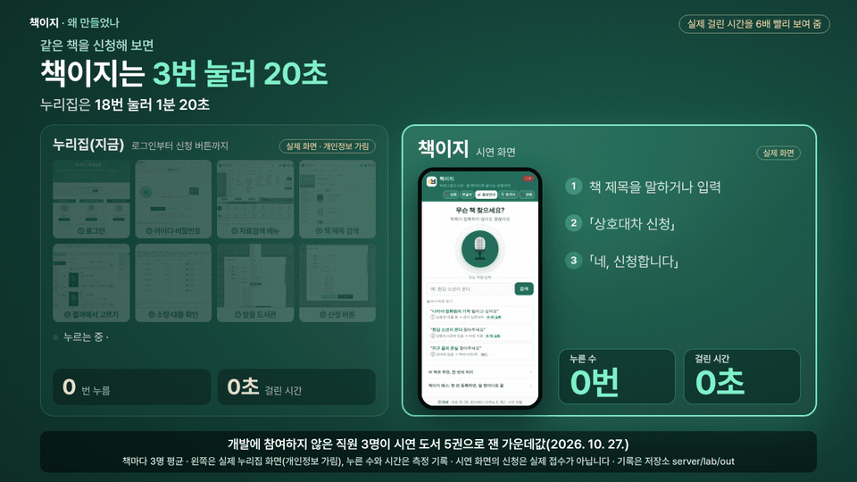
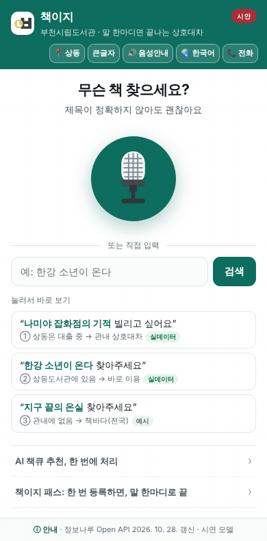
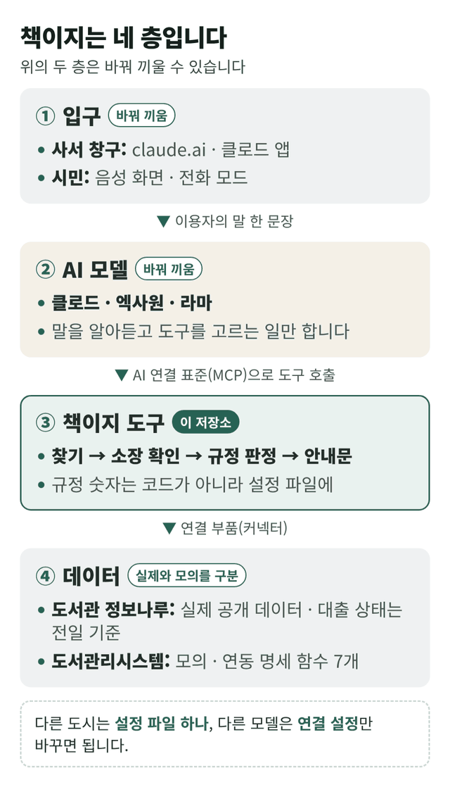

# 책이지: 말 한마디로 내 손안에 책이

> **「한강 소년이 온다, 역곡도서관에서 받을 수 있어요?」**
>
> 이렇게 물으면 책이지가 부천시립도서관 16개관의 소장·대출 상태와 상호대차 규정을 확인해, **신청이 되는지, 어떻게 받는지** 알려 줍니다. 이름은 「책이 이지(easy)」라는 뜻입니다.

  
  
  
  

같은 책으로 잰 누른 수와 걸린 시간(가운데값)입니다. 개발에 참여하지 않은 직원 3명이 시연 도서 5권으로 쟀습니다(책마다 3명 평균, 2026. 10. 27., <a href="server/lab/out/apply_steps_staff_2026-10-27.md">측정 기록</a>). 누리집은 로그인부터 상호대차 신청 버튼까지, 책이지 시연 화면은 받을 도서관을 상동으로 두고 음성으로 물어 「바로 이용」 안내를 받기까지입니다(그날 자료로 1~4번은 상동에 있었음). 화면은 따로 찍었고, 누리집 화면은 개인정보를 가렸습니다.

## 지금 바로 해 보기

- 🧑‍💼 **창구·전화 판정**(사서용, 설치 없이): [claude.ai에 주소 한 줄로 연결](#설치-없이2분)
- 📱 **시민 음성 화면**(시연): [휴대폰으로 열기](https://altarry-prog.github.io/chaekiji/)
- 🤖 **공개 모델 2종**: [코랩에서 실행](https://colab.research.google.com/github/altarry-prog/chaekiji/blob/main/server/lab/colab_model2.ipynb)

> **정직 고지**: 부천시립도서관의 공식 서비스가 아니라, 담당 사서가 직접 만들어 검증하는 도구입니다. 판정과 안내문은 실제 공개 데이터(도서관 정보나루, 대출 상태는 조회일 전일 기준)로 동작하며, 시연 웹의 신청은 실제 접수로 이어지지 않습니다.

## 한눈에 보기

**무엇인가요?** 
책을 찾아 주는 검색 도구가 아니라, 이용자의 말 한마디로 상호대차 신청이 되는지 판정하고 안내하는 AI 에이전트입니다. 정보나루의 공식 조회 도구(MCP: AI가 직접 부를 수 있는 연결 규격)가 「어느 도서관에 있고 빌릴 수 있는가」까지 답한다면, 책이지는 같은 자료로 「신청이 되는가, 어떻게 받는가」까지 답합니다. 이용자에게 읽어 줄 안내문과 사서가 옮겨 적을 접수 메모를 만들고, 접수는 지금처럼 사서가 합니다.

**누구를 위한 것인가요?** 
누구나 쓰는 도서관 상호대차를 어르신, 장애인, 다문화 주민도 말로 물어 쓸 수 있게 하는 것이 목표입니다. 지금은 창구·전화에서 사서가 쓰도록 만들었고, 시민이 휴대폰에 직접 말하는 화면은 2027년 시범 운영 제안입니다. 시민 화면은 앱 설치 없이 여는 웹으로 만들었고, 정식 서비스에서는 도서관 누리집·키오스크에 올리는 것을 전제로 했습니다.

**AI가 판정하나요?** 
말은 AI가 알아듣고, 판정은 규칙이 합니다. 규정은 누리집 안내를 옮긴 설정 파일에 있습니다. 그래서 모델이 도구의 결과를 받으면 모델이 달라도 같은 판정이 나옵니다(공개 모델 2종, 두 모델 모두 도구 결과를 받은 11건 일치, 10. 18.).

**다른 지자체도 쓸 수 있나요?** 
정보나루는 전국 공통 자료이고, 도구는 AI 연결 표준(MCP)을 따르며, 도서관 코드와 규정은 설정 파일로 바꿉니다([6절](#6-다른-도시로-넓히기)).

## 숫자로 보는 책이지

| 심사 항목 | 근거(저장소 기록) |
|---|---|
| **필⁠요⁠성** | 2025년 상호대차 320,140권(44개소). 누리집 신청은 로그인부터 18번·1분 20초 · [1절](#1-왜-만들었나-하루에도-여러-번-받는-같은-질문) · [측정 기록](server/lab/out/apply_steps_staff_2026-10-27.md) |
| **창⁠의⁠성** | 말로 물으면 판정과 안내까지 하는 음성 기반 상호대차 에이전트. 시민 화면은 10개 언어·전화 한 통 모드(시연) · [2절](#2-무엇을-하나-말-한마디에서-안내문까지) |
| **활⁠용⁠성** | claude.ai에 주소 한 줄로 설치 없이. 도구 응답 가운데값(중앙값) 2.6초, 시연 화면은 음성으로 물어 안내까지 3번·20초, 전일 기준 자료가 다음 날에도 맞은 비율 98.5% · [3절](#3-어디까지-진짜인가) · [4절](#4-해-보기) |
| **완⁠성⁠도** | 고칠 때마다 자동 시험 193건, 운영 점검 매일 7가지, 모르면 「소장 확인 불가」. 처음 보는 AI의 안내서 리허설(10. 17.·10. 30.) 반영 · [3절](#3-어디까지-진짜인가) · [변경 기록](CHANGELOG.md) |
| **확⁠산⁠가⁠능⁠성** | 전국 공통 자료(정보나루) · 규정은 설정 파일 · 도구는 MCP 표준 · MIT 라이선스. 공고의 개발 방향대로 핵심 기능(판정·안내)에 집중. 다른 지자체 5곳 규정 조사. 실측한 엑사원은 행정안전부 AI 공통기반 지원(예정) 모델 · [5절](#5-구조-네-층-바꿔-끼울-수-있게) · [6절](#6-다른-도시로-넓히기) |

## 차례

1. [왜 만들었나](#1-왜-만들었나-하루에도-여러-번-받는-같은-질문)
2. [무엇을 하나](#2-무엇을-하나-말-한마디에서-안내문까지)
3. [어디까지 진짜인가](#3-어디까지-진짜인가)
4. [해 보기](#4-해-보기)
5. [구조](#5-구조-네-층-바꿔-끼울-수-있게)
6. [다른 도시로 넓히기](#6-다른-도시로-넓히기)
7. [걸어온 길과 다음 일](#7-걸어온-길과-다음-일)
8. [문서 지도·저작권](#8-문서-지도)

## 1. 왜 만들었나: 하루에도 여러 번 받는 같은 질문

> **상호대차 서비스란**
>
> 이용하는 도서관에 없는 자료를 다른 도서관에서 빌려, 가까운 도서관에서 대출·반납할 수 있는 서비스입니다. 「도서관법」이 정한 공공도서관의 업무입니다.
>
> 부천시립도서관은 44개소를 하나의 상호대차 체계로 운영해 2025년 한 해 320,140권을 시민에게 제공했습니다. 다른 지역의 자료는 국립중앙도서관의 전국 상호대차 서비스 「책바다」로 빌릴 수 있습니다.

> "그 책 있어요? 여기로 가져다줄 수 있어요?"

도서관 창구와 전화에서 하루에도 여러 번 되풀이되는 질문입니다.

- **사서는** 매번 도서관리시스템을 조회하고, 한도·비치·연체 같은 규정을 머릿속으로 맞춰 봅니다.

- **시민은** 누리집에서 로그인부터 신청까지 18번을 눌러야 하고(직원 3명이 시연 도서 5권으로 잰 가운데값, 1분 20초, [기록](server/lab/out/apply_steps_staff_2026-10-27.md)), 규정도 스스로 맞춰야 합니다.

- **어르신·장애인·다문화 주민은** 그 과정에서 멈추기 쉽습니다.

## 2. 무엇을 하나: 말 한마디에서 안내문까지

1. **알아듣기**: 정확한 제목이 아니어도 됩니다.
2. **찾기**: 어떤 책인지 ISBN으로 확정합니다.
3. **확인하기**: 16개관의 소장·대출 상태를 봅니다(44개소 가운데 정보나루에 자료가 있는 곳, 전일 기준).
4. **판정하기**: 규정으로 갈래를 정합니다. 바로 이용, 관내 상호대차, 예약 권장, 책바다 안내 가운데 하나이며, 책을 특정하지 못하면 「도서 미확정」으로 되묻고, 자료를 확인하지 못하면 「소장 확인 불가」로 창구 조회를 안내합니다.
5. **안내하기**: 이용자에게 읽어 줄 안내문과, 사서가 옮겨 적을 접수 메모를 만듭니다.

**누가 무엇을 하나**

- **AI 모델**: 이용자의 말에서 책과 받을 도서관을 알아듣고, 책을 찾지 못하면 저자·내용을 되물어 다시 찾고, 안내문을 이용자의 언어로 옮깁니다. 말은 사람마다 다르기 때문입니다. 작은 공개 모델(매개변수 20억~30억 개)은 아직 이용자 언어로 옮기지 못했습니다(10. 18. 실측).

- **규칙(설정 파일)**: 검색 결과에서 문의한 책을 고르고, 16개관 소장·대출을 확인하고, 규정 7종을 판정하고, 안내문 틀과 접수 메모를 만듭니다. 규정은 사람마다 달라서는 안 되므로 같은 질문에는 같은 답이 나와야 합니다.

- **사서(도서관리시스템)**: 접수와 회원 한도·연체·중복 확인을 합니다. 회원 정보와 실제 처리는 사람이 맡습니다.

판정을 모델에 맡기지 않는 설계는 실측이 뒷받침합니다. 공개 모델 2종(엑사원 3.5·라마 3.2) 실측(10. 18.)의 기록표 세 차례에서 도구의 결과 없이 스스로 답한 4건은 소장 사실이 틀린 답 2건, 판정이 틀린 답 1건, 답을 미룬 1건이었습니다. 도구 11종이 모두 보였던 첫 차례에는 엑사원이 찾기 도구만 부르고 대출 상태를 지어냈습니다([기록](server/lab/out/)). 그래서 작은 공개 모델에는 호스트(모델과 도구를 잇는 실행 프로그램)가 도구 하나만 보여 주고 받을 도서관을 고정합니다.

**두 가지 쓰임**

- **지금 써 볼 수 있는 것: 창구·전화 판정.** 이용자가 창구나 전화로 물으면 사서가 책이지로 바로 판정해 안내하도록 만들었습니다. 창구에 두기 전 확인으로 원격 판 실측 15건(10. 17.), claude.ai 실제 화면(10. 20., 시연영상 첫 장면), AI 대조 시험 12건(10. 19.)을 마쳤습니다. 실제 창구에서 쓴 기록은 아직 없고, 시범 운영 단계에서 쌓습니다. 접수는 사서가 지금처럼 도서관리시스템에서 합니다.

- **시범 운영 제안: 시민 음성 화면.** 같은 판정을 시민이 음성, 10개 언어, 큰글자, 전화 모드로 쓰는 모습입니다. 지금 시연 화면은 책이지 서버와 같은 새벽 자료를 쓰고 규정 문구도 누리집 안내와 맞췄지만(10. 18.), 판정은 화면 안에 따로 넣은 규칙이 합니다. 책이지 서버의 도구에 직접 붙이는 것이 제안입니다. 신청 확인은 화면 안에서 끝나며 실제 접수로 이어지지 않습니다.

시민 음성 화면의 예시 단추 ① 「나미야 잡화점의 기적 빌리고 싶어요」: 정보나루 실제 자료 한 날짜(단추 배지에 표시)로 고정한 장면의 판정에서 접수(시연) 화면까지(실제 접수로 이어지지 않음. 직접 말하면 매일 새벽 자료로 찾고, 심사 기간에는 11. 5. 새벽 자료를 씁니다)

## 3. 어디까지 진짜인가

**실제로 동작하는 것**

- 찾기, 소장 확인, 규정 판정, 안내문, 접수 메모(정보나루 공개 데이터 사용)

- 책 고르기: 정보나루 검색 결과에서 문의에 가장 맞는 판을 고릅니다. 같은 제목·여러 판본·권차(몇 권째인지)가 있는 책은 다른 판을 고르거나 후보와 함께 되물을 수 있어, 접수 메모의 ISBN을 창구에서 확인합니다(10. 19. AI 대조 12건에서 찾은 다른 책 3건·못 찾음 2건을 고침).

- 매일 새벽 자료 갱신과 중계 서버(인증키는 서버 쪽에만 둡니다)

- 동결(2026. 11. 5. 18시)부터 결선(11. 25.)까지는 시연 도서 5종을 11. 5. 새벽 자료로 고정합니다(그 밖의 책은 그날 조회). 동결 커밋(마지막으로 저장한 판)에서 갱신을 멈추고, 그 자료를 11. 26.까지 오늘 자료처럼 씁니다. 화면·안내문에는 조회일(「2026. 11. 5. 조회」)을 그대로 밝힙니다.

- 시민 화면의 음성, 10개 언어, 판정 흐름

- **공개 모델 2종 실측**: 엑사원 3.5·라마 3.2를 깃허브 액션(깃허브의 자동 실행 서버, CPU)에서 네 차례 돌렸습니다(10. 18.). 기록표가 남은 세 차례에서 두 모델이 모두 도구의 결과를 받은 문의 11건은 판정이 같았고, 나머지 4건은 한쪽 모델이 도구의 결과 없이 답했습니다. 작은 모델은 판정이 같아도 안내문을 옮기며 도서관 이름이나 대출 상태를 틀리게 적었고(두 모델 모두), 베트남어 문의에는 기록된 여섯 번 모두 한국어로만 답했습니다. 차례 사이에 호스트를 고쳤으므로(받을 도서관·언어 고정 등) 같은 조건을 되풀이한 결과는 아닙니다([기록표 3개와 원 기록](server/lab/out/)).

**시연이거나 모의인 것**

- **상호대차 접수**: 실제로 들어가지 않습니다. 도서관리시스템 연결은 모의이며, 그 함수 7개가 곧 업체 연동 명세입니다.

- **회원 정보**: 가상 인물입니다. 한도·연체·중복은 창구에서 확인합니다.

- **책이지 패스(사전 위임)**: 위임 흐름은 진짜, 위임장 보존과 통지는 시연입니다.

- **전화 한 통 모드**: 대화 흐름은 진짜, 전화망 연결은 시연입니다.

- **시민 화면 예시 단추 ③(지구 끝의 온실)**: 관내에 없는 책의 흐름(책바다 안내)을 보이려고 꾸민 장면입니다. 직접 말하거나 입력해도 이 장면으로 나오며, 이 책은 실제로는 부천 관내에 있습니다.

- **대체자료·월간 추천**: 예시 데이터입니다.

- **판정 규정값**: 부천시립도서관 누리집 상호대차 안내(2026. 8. 10. 수정판)와 맞췄습니다(10. 18.). 안내에 없는 자료 유형·신착 여부는 창구 확인으로 두고, 미수령 제재(7일)는 안내문으로 알리기만 합니다.

**기기에 따라 다른 것**

- 패스키, 바코드, 기기 안 음성 인식, WebMCP(브라우저 안의 AI가 화면의 도구를 부르는 표준 초안): 지원하는 기기와 브라우저에서만 동작합니다.

- 외국어 음성 인식: 기기가 알아듣는 언어 범위를 따릅니다.

- 음성을 글자로 바꾸는 곳: 책이지 쪽 서버는 없지만, 크롬 등은 음성을 브라우저 회사의 서버에서 글자로 바꿀 수 있습니다. 기기 안 인식을 지원하는 기기·언어에서는 기기 안에서 바꿉니다.

**자료는 어디서 오나요?** 그날 새벽에 받은 자료를 먼저 씁니다(심사 기간에는 11. 5. 새벽 자료). 그 자료에 없는 책은 중계 서버로 그 자리에서 조회하고(가운데값 2.7초, 10. 17. 실측), 그것도 안 되면 2026. 8. 18. 실측값을 씁니다. 실측값도 없는 책은 「없다」고 하지 않고 「소장 확인 불가(창구에서 조회)」로 답합니다. 어느 자료를 썼는지는 안내문의 조회일로 보입니다.

**기대효과(잰 것과 재지 않은 것)**

- **업무시간 단축**: 사서가 책을 찾고 16개관 소장·대출을 보고 규정을 맞춰 보던 첫 확인을 도구 한 번이 대신합니다(도구 응답 가운데값 2.6초. claude.ai 화면에서 모델이 답을 다 쓰기까지는 약 50초 걸린 기록이 있습니다, 10. 20. 화면 녹화). 최종 확인과 접수는 지금처럼 사서가 하며, 사서 1건당 줄어드는 시간은 아직 재지 않았습니다. 시민 쪽은 같은 시연 도서 5권으로 잰 결과 누리집은 신청 버튼까지 18번·1분 20초, 시연 화면은 음성으로 물어 안내를 받기까지 3번·20초였습니다(직원 3명, 10. 27., 1~4번은 받을 도서관에 있어 「바로 이용」 안내).

- **품질 향상**: 판정은 규칙이 하므로, 모델이 도구의 결과를 받으면 모델이 달라도 같은 판정이 나옵니다(공개 모델 2종, 두 모델 모두 도구 결과를 받은 11건 일치). 안내문마다 조회일과 그 책의 누리집 주소를 밝히고, 확인하지 못한 책은 「소장 확인 불가」로 창구 조회에 넘깁니다.

- **비용 절감**: 정보나루 공개 자료, 무료 클라우드, 외부 패키지 1개(PyYAML)로 돌아갑니다. 도서관리시스템 업체는 연계에 비용·호출 제한이 없다고 회신했습니다(10. 21.). 도입 비용은 추정하지 않았습니다.

**전일 기준인데 쓸모가 있나요?** 책이지는 신청 전 안내와 첫 확인용으로 만들었습니다. 최종 확인과 접수는 지금처럼 사서가 도서관리시스템에서 합니다. 시연 도서 5종 × 16관에서 앞날 「대출 가능」이던 667쌍 가운데 657쌍(98.5%)이 다음 날 자료에서도 「대출 가능」이었습니다(2026. 10. 16.~28., [기록](server/lab/out/stability_2026-10-16_2026-10-28.md)). 표본이 작아(시연 도서 5종) 참고용이며, 정보나루 자료끼리 견준 값이라 실시간 시스템과 견준 값은 아닙니다. 실시간 조회는 도서관리시스템 업체가 연계할 수 있다고 회신했습니다(10. 21., [7절](#7-걸어온-길과-다음-일)).

**안정성과 사용 편의성**

- 핵심 기능(찾기·소장 확인·판정·안내문·접수 메모)은 아래 자동 시험 193건이 코드를 고칠 때마다 지킵니다. 운영 점검은 매일 7가지(시연 웹·중계·원격 판)를 봅니다.

- 사서는 claude.ai에 주소 한 줄만 넣으면 설치 없이 씁니다(2분 안팎, 추정). 설치형은 명령 하나(`run.bat`·`run.sh`)로 서버 시험 104건을 돌려 「준비 완료」를 확인합니다.

- 응답 시간: 문의 15건에서 도구가 답을 돌려주기까지 가운데값(중앙값) 2.6초였습니다(2026. 10. 17. 미국 쪽 서버에서 측정, 네트워크 포함·모델이 답을 쓰는 시간 제외. 새벽 자료에 있는 책 5건은 0.2초 안팎, 그 자리에서 조회한 책 10건은 가운데값 2.7초, [기록](server/lab/out/consult_timing_2026-10-17.md)). 그 뒤 원격 판 배포 점검 6회(10. 27.~30.) 가운데 3회는 목록 밖 책의 소장 조회가 정보나루 응답 지연으로 9~30초 뒤 끊겼고(성공한 3회는 3.7~22.9초), 그럴 때는 「소장 확인 불가(창구에서 조회)」로 답합니다(`relay/last_deploy.json`의 커밋 이력).

- 시민 음성 화면은 자동 접근성 점검(axe-core)에서 WCAG 2.2 AA 위반 0건이었습니다(10. 30., v1.12.20, 휴대폰·PC 24화면).

- 4절의 길 가운데 claude.ai 연결, 설치형(우분투), 공개 모델(깃허브 액션)은 해 본 기록이 있습니다. 클로드 데스크톱 연결과 코랩 직접 실행은 아직 해 보지 않은 예시입니다.

**어떻게 확인하나**: 서버·중계 코드를 고칠 때마다 아래 자동 시험을 모두 다시 돌립니다(마지막 실행 2026. 10. 29., [실행 기록](https://github.com/altarry-prog/chaekiji/actions/workflows/tests.yml)).

| 시험 | 건수 |
|---|---|
| 책이지 서버 | 104 |
| 원격 판(claude.ai 연결용) | 38 |
| 두 판 대조 | 31 |
| 중계 | 20 |
| **합계** | **193** |

- 서버 시험은 판정 규칙, 저장, 중계 연결, 공개 모델 연결(모의 Ollama)을 봅니다. 두 판 대조는 책이지 서버와 원격 판의 답이 글자까지 같은지 봅니다. 설치형에서는 `run` 명령으로 이 가운데 서버 시험 104건을 돌립니다.

- 이와 따로 운영 점검이 매일 7가지(시연 웹·중계·원격 판)를 봅니다.

- 서버 시험은 2026. 8. 28. 17건(8. 30. 33건)에서 시작해 결함을 찾아 고칠 때마다 늘렸습니다.

## 4. 해 보기

### 설치 없이(2분)

**창구·전화 판정: 인터넷 창의 claude.ai에서**

1. claude.ai에서 「사용자 정의 → 커넥터 → + 추가 → 커스텀 커넥터 추가」를 누릅니다.
2. 이름(예: 책이지)과 주소 `https://chaekiji-relay.altarry2.workers.dev/mcp`를 넣고 「계속」, 감지된 인증 설정이 나오면 다시 「계속」을 누른 뒤, 인증 방식은 「로그인 없음」을 골라 「추가」를 누릅니다.
3. 새 대화의 「+ → 커넥터」에서 켜고, 이용자의 말을 그대로 적습니다.

   > 한강 소년이 온다 빌리고 싶어요, 역곡도서관에서 받을게요

   판정 한 줄과 이용자 안내문(조회일 포함)이 돌아옵니다. 도구는 접수 메모도 함께 돌려주며, 클로드의 답에 빠졌으면 「접수 메모도 보여 줘」라고 하면 됩니다.

늘 답이 나오는 책은 매일 새벽 자료에 든 다섯 권(소년이 온다 · 나미야 잡화점의 기적 · 불편한 편의점 · 설민석의 한국사 대모험 · 지구 끝의 온실)입니다. 그 밖의 책은 그날 정보나루 호출 한도·응답에 따라 「소장 확인 불가(창구에서 조회)」가 뜰 수 있으며, 이는 정상 동작입니다.

이 원격 판은 읽기와 판정만 합니다(도구 3종). 책이지 서버와 같은 입력에 같은 답을 내는지 자동 대조합니다(31건). 무료 요금제는 커스텀 커넥터를 1개까지 쓸 수 있고, 팀 요금제는 소유자만, 기업 요금제는 소유자와 권한을 받은 역할만 추가할 수 있습니다. 이 주소를 인터넷 창으로 열면 붙이는 법이 나옵니다.

**시민 음성 화면**: 휴대폰 크롬이나 사파리로 [시연 웹](https://altarry-prog.github.io/chaekiji/)을 열고 마이크를 허용합니다. 예시 단추 세 개가 세 갈래를 보여 줍니다(①②는 정보나루 실제 자료 한 날짜로 고정한 장면, ③은 꾸민 예시 장면).

**공개 모델 2종(코랩에서)**: [노트북](https://colab.research.google.com/github/altarry-prog/chaekiji/blob/main/server/lab/colab_model2.ipynb)을 열고 「런타임 → 모두 실행」을 누릅니다. 엑사원 3.5와 라마 3.2가 같은 문의 5건을 처리하고 기록표를 만들도록 짰습니다(코랩이 빌려주는 T4 GPU로 10~15분, 추정). 코랩에서 직접 돌린 기록은 아직 없고, 같은 코드 칸을 깃허브 액션에서 돌린 기록만 있습니다(3절 참고).

### 설치형(10분)

1. **준비와 시험**: 아래 하나면 됩니다. 시험 104건을 돌리고 「준비 완료」를 찍습니다. 인터넷은 처음 한 번 PyYAML을 설치할 때만 씁니다(설치를 막아 둔 파이썬이면 server 폴더 안의 가상환경(.venv)에 설치합니다).

       Windows:      server\run.bat
       macOS·Linux:  sh server/run.sh

2. **모델 없이 결과 보기**: 책이지 도구를 한 번 불러 판정, 안내문, 접수 메모를 봅니다. 둘째 값이 받을 도서관입니다(macOS·Linux는 `python3`).

       python server/lab/consult_cli.py "한강 소년이 온다 빌리고 싶어요" 역곡

3. **클로드 데스크톱(연결 예시)**: [`server/claude_desktop_config.example.json`](server/claude_desktop_config.example.json)대로 등록하고 프롬프트 **consult**를 고르는 방식입니다(설정 파일 예시이며, 이 방식으로 연결해 본 기록은 아직 없습니다).
4. **공개 모델(Ollama)**: Ollama를 설치하고 모델을 받은 뒤 같은 서버를 돌립니다. 모델에게는 판정 도구(`consult_request`) 하나만 보이고 받을 도서관을 고정합니다(macOS·Linux는 `python3`).

       ollama pull exaone3.5:2.4b
       python server/hosts/ollama_host.py --model exaone3.5:2.4b --tools consult --pickup 역곡

설치와 연결은 [server/README.md](server/README.md), 모델 2종 절차는 [server/docs/모델2종-구동.md](server/docs/모델2종-구동.md)에 있습니다.

## 5. 구조: 네 층, 바꿔 끼울 수 있게

- **입구와 모델은 바꿔 끼울 수 있습니다.** 도구와 데이터 연결은 그대로입니다.
- **규정 숫자는 코드가 아니라 설정 파일에** 있습니다([`server/config/*.yaml`](server/config/)).
- AI 연결 표준인 **MCP**는 AI 모델이 외부 도구를 부르는 공통 방식입니다. 클로드, 엑사원, 라마가 같은 도구를 부릅니다.

폴더별로 무엇이 있나

- [`index.html`](index.html) · [`sw.js`](sw.js): 시민용 음성 화면(설치형 웹 앱)
- [`server/`](server/): 책이지 서버(MCP 참조 서버, 파이썬) · 시험 · 설정 · 지시문
- [`server/lab/out/`](server/lab/out/): 실측 기록(처리 시간, 공개 모델 2종, 전일 기준 유지율, 신청 절차 직원 측정)
- [`relay/`](relay/): 정보나루 중계와 원격 판(claude.ai 연결용, Cloudflare Workers)
- [`data/`](data/): 매일 새벽 갱신 자료
- [`docs/`](docs/): 사진, 구조 그림, 시민 화면 기능 상세, 시연영상 구성표·자막
- [`mcp.html`](https://altarry-prog.github.io/chaekiji/mcp.html) · [`console.html`](https://altarry-prog.github.io/chaekiji/console.html): 확산 모델 설계도, 도구 호출 콘솔(누르면 그 화면이 열림)

## 6. 다른 도시로 넓히기

**재사용과 범정부 공동활용**: 책이지는 국립중앙도서관이 제공하는 전국 공통 데이터(도서관 정보나루)를 쓰고, 판정 도구는 AI 연결 표준(MCP)을 따르며, 저장소 전체가 MIT 라이선스입니다. 그래서 다른 지자체·기관의 도서관도 도서관 코드와 상호대차 규정(신청 한도·보관 기간 등)을 설정하면 같은 방식으로 재사용할 수 있습니다(책이지 서버는 설정 파일만, 원격 판과 시민 화면은 아래처럼 도서관 코드 표도 바꿈). 판정·실행 계층은 정보나루 공식 MCP(조회) 위에 얹는 공동활용 계층으로 제안합니다.

- **책이지 서버(파이썬 참조 서버)**: 도서관 코드와 규정 숫자를 담은 설정 파일 하나만 새로 쓰면 됩니다(반나절, 추정). 원격 판을 쓰려면 중계([`relay/worker.js`](relay/worker.js))의 도서관 코드 표도 바꾸고 그 도시의 인증키로 중계를 따로 올려야 하며, 시민 화면은 [`index.html`](index.html)의 도서관 코드 표를 바꾸면 됩니다. 2026년 9월에 다른 지자체 다섯 곳(서울 강남구·광진구, 청주시, 부산시, 용인시)의 공개 안내를 견줘 보니 1인 한도(2\~5권), 보관 기간(2\~3일), 미수령 제재(1주\~30일), 도착 시각이 곳마다 달랐습니다(광진구는 도착 시각만 확인). 한도·보관 기간·도착 안내·제외 자료는 지금도 설정 값으로 바꿀 수 있고, 휴관일을 뺀 보관일 계산과 미수령 누적 기준은 다음 판 설정 초안에 넣었습니다(자세히는 [v0.4 로드맵](server/docs/ROADMAP-v0.4.md)).

- **접수까지 자동으로**: 도서관리시스템 종류마다 연결 부품(커넥터)을 하나씩 만듭니다. 개발량은 도시 수가 아니라 시스템 종류의 수만큼 늘어납니다.

- **화면은 바꿔 끼우기**: 창구 PC, 도서관 누리집, 키오스크가 같은 도구를 부르면 됩니다.

**기존 방식과 다른 점(독창성)**: 누리집 검색과 정보나루 공식 MCP(국립중앙도서관)는 「어디에 있고 빌릴 수 있는가」(**조회**)까지 답합니다. 책이지는 그 위에 다음을 더합니다.

- 말로 묻고 말로 듣습니다. 시민 음성 화면은 음성 인식·음성 안내·10개 언어·전화 한 통 모드로, 화면을 다루기 어려운 이용자도 말 한마디로 판정과 안내를 받도록 설계했습니다(지금은 시연, 음성 인식은 기기·브라우저가 지원하는 언어만).

- 상호대차 규정 판정과 안내문·접수 메모(**판정과 실행** 계층)를 얹습니다.

- 말을 알아듣는 일은 AI가, 판정은 설정 파일의 규칙이 맡습니다. 그래서 도구를 제대로 부르면 모델이 달라도 같은 판정이 나옵니다(10. 18. 실측, 두 모델 모두 도구 결과를 받은 11건 일치).

- 도구를 MCP 표준으로 두어 클로드·엑사원·라마가 같은 도구를 부릅니다.

- 접수 같은 실행은 그 자리의 확인이나 범위를 정한 사전 위임(책이지 패스) 안에서만 하도록 설계했습니다. 지금 접수는 모의이며, 위임 흐름은 진짜, 위임장 보존과 통지는 시연입니다.

**지속적인 운영·개선**

- 새벽 자료 갱신과 운영 점검 7가지를 깃허브 액션으로 자동화했습니다(심사 기간에는 시연 도서 5종을 11. 5. 새벽 자료로 고정).

- 결함을 찾을 때마다 시험을 늘렸습니다(서버 시험 17건에서 시작해 지금 모두 193건). 다음 판 계획은 [v0.4 로드맵](server/docs/ROADMAP-v0.4.md)에, 바뀐 것은 [CHANGELOG](CHANGELOG.md)에 적어 이어 갑니다.

- 지금은 무료 클라우드와 인증키 1개이며, 기관 환경으로 옮기는 일은 7절의 남은 길입니다.

## 7. 걸어온 길과 다음 일

| 때 | 판과 바뀐 것 |
|---|---|
| 8월 | 화면 v1.0 · 서버 v0.3: 첫 공개, 16개관 실측 64건 |
| 9월 | 화면 v1.2\~v1.7: 운영 규정 반영(예약 분기·책바다 안내), 전화 한 통 모드, 음성 인식 보강 · 다른 지자체 5곳 규정 조사 |
| 10.&nbsp;13. | 화면과 서버를 한 저장소로 |
| 10.&nbsp;15. | 서버 v0.3.4: 사서용 상담 비서로 |
| 10.&nbsp;16. | 서버 v0.3.5 · 원격 상담 비서: claude.ai에 주소 한 줄로 연결 |
| 10.&nbsp;18. | 공개 모델 2종 실측(깃허브 액션, 네 차례) · 누리집 규정값 반영(화면 v1.12.4) |
| 10.&nbsp;19. | 화면 v1.12.6 · 책 고르기·판본 보정 |
| 10.&nbsp;26. | 화면 v1.12.7·v1.12.8 · 정직 표시 문구(완료 음성의 시연 표시, 예약 「바꿔 신청할 수 있음」, 책바다 「실제로 문자는 보내지 않아요」, 「지금」 대신 조회일을 말하는 화면·음성 등 10개 언어) |
| 10.&nbsp;27. | 화면 v1.12.9~v1.12.14 · 전화 모드 「없지만」 갈래·오늘 자료로 답하기 · 한국어 음성 겹침 정리 · 흰 화면 대비(애니메이션 멈춤 · 시작 안전장치 · 화면 틀 점검 · 간단 모드) · 동결을 10.&nbsp;30.로 앞당김 |
| 10.&nbsp;28. | 화면 v1.12.15\~v1.12.19 · 예시 단추 순서(① 관내 상호대차 ② 바로 이용) · 자동 접근성 점검(axe-core, WCAG 2.2 AA 위반 0건, 본문·머리 영역 표시) · 이름을 「책이지」 하나로 · 최종 점검(③ 예시 장면 표시, 「추천」 꼬리표, 접수 화면 「(시연)」) |
| 10.&nbsp;30. | 화면 v1.12.20~21 · 직원 의견(처음 안내, 받는 방법 칸, 시민 화면 「안내데스크」) · 예시 단추를 실제 자료 한 날짜로(②는 불편한 편의점) · 시연 도서 표지 · 읽기 쉽게 · 처음 안내를 닫을 때 음성 시작 화면이 비치지 않게 · 1차 검수(독립 검토 3건) · 동결을 11.&nbsp;5.로 옮김 |

자세한 이력은 [CHANGELOG.md](CHANGELOG.md)에 있습니다.

### 정식 활용까지 남은 길

2026. 9. 8. 국무회의에 보고된 「공무원의 AI 활용 직접개발 활성화 및 확산 방안」은 공무원이 직접 만든 도구를 실험·검증, 운영·관리, 정식 정보화 사업의 3단계로 관리한다고 밝혔습니다. 이 대회도 우수작을 2027년 정보화사업 연계 등으로 지원해 범정부 공동활용 서비스로 제공하는 것을 검토한다고 밝혔습니다(행사계획, 예산에 따라 달라질 수 있음). 책이지는 지금 첫 단계이며, 그 길에 맞춰 웹과 AI 연결 표준(MCP), 설정 파일로 만들었습니다. 아래는 다음 단계까지 남은 일과 푸는 길입니다.

- **조회 자료**: 지금은 정보나루 전일 기준이고, 다음은 도서관리시스템의 실시간 소장·대출 조회입니다. 업체는 연계할 수 있고 비용·호출 제한이 없다고 회신했으며(10. 21.), 시 보안 정책에 따른 접속 허용이 먼저입니다.

- **찾는 범위**: 지금은 시연 도서 5종을 새벽 자료로, 그 밖의 책을 그 자리 조회(정보나루 하루 500회)로 찾습니다. 다음은 부천 소장 자료 전체이며, 서버 IP를 등록하면 하루 30,000회로 늘어납니다.

- **음성**: 지금은 브라우저 음성 인식이고, 다음은 발음이 달라도 책을 가려내는 음성 상담입니다(아래 실험).

- **접수**: 지금은 사서가 도서관리시스템에서 하고, 다음은 사서나 이용자가 승인한 범위 안의 접수입니다. 업체 연계 규격에 신청·진행 조회가 있으며(10. 21. 확인), 회원번호가 들어가므로 개인정보 처리 근거와 본인 확인이 먼저입니다.

- **운영·보안**: 지금은 무료 클라우드와 인증키 1개, 자가 점검이고, 다음은 기관 환경·고정 IP·보안 검증입니다. 이는 이 대회 우수작 지원 계획의 항목(보안 검증·품질 보증·유지 관리, 2027년 예산에 따라 달라질 수 있음)과 겹칩니다.

- **화면**: 지금은 깃허브 페이지에 올린 시연 웹이고, 다음은 도서관 누리집·키오스크에 올리는 정식 웹 서비스입니다. 음성·큰글자·10개 언어·전화 한 통 모드는 장애인·고령자·다문화 주민 당사자와 함께 시험해 다듬습니다.

- **다른 도서관**: 지금은 가상 도시 설정으로 바꿔 끼우는 시험까지이고, 다음은 같은 도서관리시스템을 쓰는 도서관 1곳과의 공동 시범입니다.

제출본은 창구·전화에서 쓰도록 만든 책이지와 시연 도서 중심의 시민 화면입니다. 시민 화면이 시연 도서 밖의 책도 찾고 발음이 달라도 책을 가려내는 기능은 별도 시험 저장소에서 실험해 두었습니다.

최근 도서 5권은 모두 찾아 판정했고(10. 20.), 음성 보정은 글로 쓴 모의 문장 180개(사전 안 150개·사전 밖 30개)로 시험했습니다(10. 22., 50권 모의 사전). 사전 안 문장을 바로 맞힌 비율이 글자 비교 20%에서 소리 비교 96%로 올랐고, 180개 가운데 틀린 책을 고른 경우는 한 건도 없었습니다. 다만 소리 비교가 같게 보는 틀림 위주로 만든 문장이고 실제 녹음이 아니어서, 실제 목소리에서는 낮아질 수 있습니다. 심사 기간의 안정을 위해 제출본에는 넣지 않았고, 시범 운영 단계에서 두 번째 인증키·서버 IP 등록과 함께 넣을 계획입니다.

**직원 측정 의견(10. 27.·10. 30.)**: 개발에 참여하지 않은 직원 3명이 누리집 신청 절차와 시연 화면을 재며 남긴 의견 7건(안내 글 줄이기와 그림, 가까운 도서관 순서, 제목 오타 보정, 작은도서관 소장 안내, 표지와 상세 서지, 판 확인, 반납 예정일 안내)과 10. 30.에 더한 의견 4건(시민 화면의 「창구」를 「안내데스크」로, 처음 오는 이용자를 위한 상호대차 안내, 비슷한 책 추천, 받는 방법 정리)을 [측정 기록](server/lab/out/apply_steps_staff_2026-10-27.md)에 다음 일과 함께 적어 두었습니다. 판 확인은 책이지 서버에 이미 있고, 안내데스크·처음 안내·받는 방법과 표지는 시연 웹 v1.12.20에 넣었으며, 나머지는 다음 판, 시범 운영 단계, 도서관리시스템 연계 뒤로 나눠 적었습니다.

## 8. 문서 지도

- 책이지 서버 설치·연결·도구 계약: [server/README.md](server/README.md)
- 사서 모드 지시문: [server/prompts/상담비서-지시문.md](server/prompts/상담비서-지시문.md)
- 모델 2종 구동: [server/docs/모델2종-구동.md](server/docs/모델2종-구동.md)
- 실측 기록 보기: [처리 시간](server/lab/out/consult_timing_2026-10-17.md) · [공개 모델 2종](server/lab/out/) · [전일 기준 유지율](server/lab/out/stability_2026-10-16_2026-10-28.md) · [신청 절차 직원 측정](server/lab/out/apply_steps_staff_2026-10-27.md)
- 중계와 원격 판: [relay/README.md](relay/README.md)
- 시민 화면 기능 상세: [docs/시연웹-기능-상세.md](docs/시연웹-기능-상세.md)
- 시연영상 장면과 자막(영상 4분 58초는 따로 제출): [구성표](docs/시연영상-구성표.md) · [자막](docs/시연영상-자막.srt)
- 다음 판 계획: [server/docs/ROADMAP-v0.4.md](server/docs/ROADMAP-v0.4.md)
- 변경 기록: [CHANGELOG.md](CHANGELOG.md) · [server/CHANGELOG.md](server/CHANGELOG.md)

**함께 보기**

- 공공 GitLab: 제출본 https://gitlab.aigov.go.kr/altarry/chaekiji-challenge (2026. 11. 6. 등록 예정, 비공개: 심사위원 열람용) · 공개 초안 https://gitlab.aigov.go.kr/altarry/chaekiji (가져오기로 옮긴 사본, 최신은 이 저장소)

- 데이터 출처: 도서관 정보나루 Open API(국립중앙도서관). 대체자료와 월간 추천은 예시 데이터입니다.

## 저작권과 문의

© 2026 책이지(Chaekiji) 프로젝트 · 부천시립상동도서관

- **저장소 전체(시연 웹·중계·참조 서버)**: 다른 도서관이 그대로 가져다 쓰고 고쳐 쓸 수 있도록 **MIT 라이선스**로 공개합니다([LICENSE](LICENSE)). 시연 웹은 실현 가능성을 검증하는 시연 모델이며, 신청은 실제 접수로 이어지지 않습니다.

- **함께 쓰는 남의 것**: 정보나루에서 받은 소장·대출 자료([`data/`](data/), [`server/fixtures/`](server/fixtures/))는 국립중앙도서관 도서관 정보나루의 이용 조건(출처 표시)을 따릅니다. 설계도·콘솔 화면이 불러 쓰는 웹 글꼴(IBM Plex)은 SIL 오픈 폰트 라이선스(OFL)를 따릅니다. 시연 도서 표지 그림([`covers/`](covers/))은 각 출판사의 저작물로, 책을 알아보는 데에만 작게 줄여 쓰며 MIT 라이선스 대상이 아닙니다.

문의: 부천시립상동도서관 이완재 (altarry@korea.kr)

행정안전부 「AI 정부 실험실」 과제 · 부천시립도서관 AI 서비스 도입 TF
