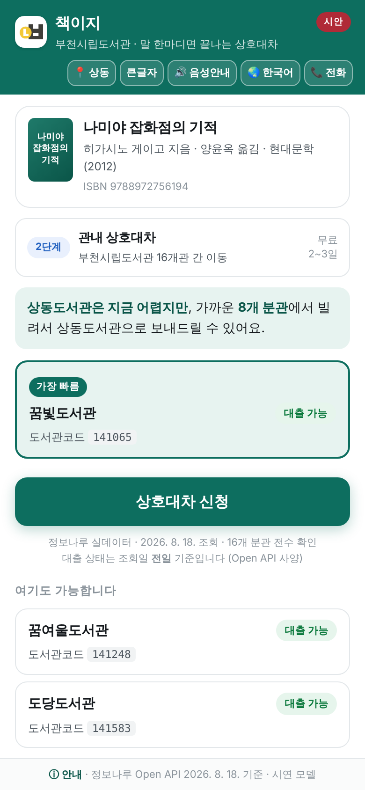
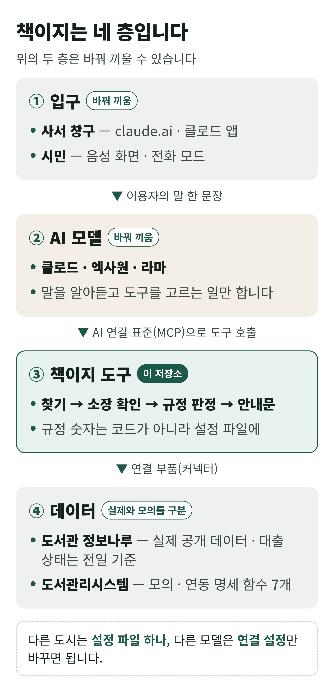

# 책이지 — 말 한마디로 내 손안에 책이

**도서관 상호대차 상담을 돕는 AI 에이전트입니다.**

이용자의 말 한마디로 책을 찾습니다. 부천시립도서관 16곳의 소장·대출 상태를 확인하고, 상호대차가 되는지 규정으로 판정해 안내문까지 만듭니다.

이름은 「책이 이지(easy)」라는 뜻입니다.

  
  
  
  

> **정직 고지** — 부천시립도서관의 공식 서비스가 아니라, 담당 사서가 직접 만들어 검증하는 도구입니다. 판정과 안내문은 실제 공개 데이터(도서관 정보나루)로 동작하지만 **접수는 하지 않습니다.** 대출 상태는 조회일의 **전일 기준**입니다.

## 지금 바로 해 보기

- 🧑‍💼 **상담 비서(사서용)** — [claude.ai에 연결](#설치-없이--1분)
- 📱 **시민 음성 화면** — [휴대폰으로 열기](https://altarry-prog.github.io/chaekiji/)
- 🤖 **공개 모델 2종** — [코랩에서 실행](https://colab.research.google.com/github/altarry-prog/chaekiji/blob/main/server/lab/colab_model2.ipynb)
- 🎬 **1분 영상** — [보기](https://github.com/altarry-prog/chaekiji/blob/main/docs/video-demo.mp4)

시민 음성 화면에서 「나미야 잡화점의 기적 빌리고 싶어요」라고 말했을 때의 판정 결과

## 차례

1. [왜 만들었나](#1-왜-만들었나--하루에도-여러-번-받는-같은-질문)
2. [무엇을 하나](#2-무엇을-하나--말-한마디에서-안내문까지)
3. [어디까지 진짜인가](#3-어디까지-진짜인가)
4. [해 보기](#4-해-보기)
5. [구조](#5-구조--네-층-바꿔-끼울-수-있게)
6. [다른 도시로 넓히기](#6-다른-도시로-넓히기--설정-파일-하나)
7. [걸어온 길과 다음 일](#7-걸어온-길과-다음-일)
8. [문서 지도·저작권](#8-문서-지도)

## 1. 왜 만들었나 — 하루에도 여러 번 받는 같은 질문

> "그 책 있어요? 여기로 가져다줄 수 있어요?"

도서관 창구와 전화에서 하루에도 여러 번 되풀이되는 질문입니다.

- **사서는** 매번 도서관리시스템을 조회하고, 한도·비치·연체 같은 규정을 머릿속으로 맞춰 봅니다.
- **시민은** 누리집 로그인부터 신청까지 화면을 아홉 번 넘깁니다. 규정은 이용자가 스스로 맞춰야 합니다.
- **어르신·시각장애인·다문화 주민은** 그 앞에서 멈춥니다.

## 2. 무엇을 하나 — 말 한마디에서 안내문까지

1. **알아듣기** — 정확한 제목이 아니어도 됩니다.
2. **찾기** — 어떤 책인지 ISBN으로 확정합니다.
3. **확인하기** — 16개 도서관의 소장·대출 상태를 봅니다(정보나루, 전일 기준).
4. **판정하기** — 규정으로 갈래를 정합니다. 바로 이용, 관내 상호대차, 예약 권장, 책바다 안내 가운데 하나입니다.
5. **안내하기** — 이용자에게 읽어 줄 안내문과, 사서가 옮겨 적을 접수 메모를 만듭니다.

AI 모델은 말을 알아듣고 도구를 고르는 일만 합니다. 조회와 판정은 규칙으로 짠 도구가 하므로, 도구를 제대로 부르면 어느 모델이든 판정이 같고 비용도 거의 들지 않습니다. 작은 공개 모델은 도구를 부르지 못하거나 추측으로 답하기도 해서(10. 18. 실측), 호스트가 도구 하나만 보여 주고 받을 도서관을 고정합니다.

**두 가지 쓰임**

- **지금 쓸 수 있는 것 — 상담 비서.** 창구와 전화의 사서가 씁니다. 접수는 사서가 지금처럼 도서관리시스템에서 합니다.
- **시범 운영 제안 — 시민 음성 화면.** 같은 도구를 시민이 음성, 10개 언어, 큰글자, 전화 모드로 씁니다. 신청 확인까지 화면 안에서 끝나며 실제 접수로 이어지지는 않습니다.

## 3. 어디까지 진짜인가

**실제로 동작하는 것**

- 찾기, 소장 확인, 규정 판정, 안내문, 접수 메모 — 정보나루 공개 데이터 사용
- 매일 새벽 자료 갱신과 중계 서버 — 인증키는 서버 쪽에만 둡니다
- 심사 기간(2026. 11. 8.~11. 25.)에는 11. 8. 새벽 자료로 고정합니다 — 11. 8. 18시 동결 커밋에서 갱신을 멈추고, 그 자료를 11. 26.까지 오늘 자료처럼 씁니다. 화면·안내문에는 조회일(「2026. 11. 8. 조회」)을 그대로 밝힙니다.
- 시민 화면의 음성, 10개 언어, 판정 흐름
- AI 연결 표준(MCP) 서버 — 시험 104건 통과(2026. 10. 19.)

**시연이거나 모의인 것**

- **상호대차 접수** — 실제로 들어가지 않습니다. 도서관리시스템 연결은 모의이며, 그 함수 7개가 곧 업체 연동 명세입니다.
- **회원 정보** — 가상 인물입니다. 한도·연체·중복은 창구에서 확인합니다.
- **책이지 패스(사전 위임)** — 위임 흐름은 진짜, 위임장 보존과 통지는 시연입니다.
- **전화 한 통 모드** — 대화 흐름은 진짜, 전화망 연결은 시연입니다.
- **판정 규정값** — 부천시립도서관 누리집 상호대차 안내(2026. 8. 10. 수정판)와 맞췄습니다(10. 18.). 안내에 없는 자료 유형·신착 여부는 창구 확인으로 두고, 미수령 제재(7일)는 안내문으로만 알립니다.
- **공개 모델 2종 실측** — 모의 시험은 통과했습니다. 실제 모델 실측은 코랩 노트북으로 【10. 19.】에 합니다.

**기기에 따라 다른 것**

- 패스키, 바코드, 기기 안 음성 인식, WebMCP — 지원하는 기기와 브라우저에서만 동작합니다.
- 외국어 음성 인식 — 기기가 알아듣는 언어 범위를 따릅니다.

## 4. 해 보기

### 설치 없이 — 1분

**상담 비서 — 인터넷 창의 claude.ai에서**

1. claude.ai에서 「사용자 정의 → 커넥터 → + 추가 → 커스텀 커넥터 추가」를 누릅니다.
2. 주소 칸에 `https://chaekiji-relay.altarry2.workers.dev/mcp` 를 넣고 「계속」, 인증 방식은 「로그인 없음」을 고른 뒤 「추가」를 누릅니다.
3. 새 대화의 「+ → 커넥터」에서 켜고, 이용자의 말을 그대로 적습니다.

   > 나미야 잡화점의 기적 빌리고 싶어요, 상동에서 받을게요

   판정 한 줄, 이용자 안내문(조회일 포함), 접수 메모가 돌아옵니다.

이 인터넷용 판은 읽기와 판정만 합니다(도구 3종). 파이썬 판과 같은 입력에 같은 답을 내는지 자동으로 대조합니다(31건). 무료 요금제는 커스텀 커넥터를 1개까지 쓸 수 있고, 팀·기업 요금제는 소유자만 추가할 수 있습니다. 이 주소를 인터넷 창으로 열면 붙이는 법이 나옵니다.

**시민 음성 화면** — 휴대폰 크롬이나 사파리로 [시연 웹](https://altarry-prog.github.io/chaekiji/)을 열고 마이크를 허용합니다. 예시 단추 세 개가 세 갈래를 보여 줍니다.

**공개 모델 2종 — 코랩에서** — [노트북](https://colab.research.google.com/github/altarry-prog/chaekiji/blob/main/server/lab/colab_model2.ipynb)을 열고 「런타임 → 모두 실행」을 누릅니다. 엑사원 3.5와 라마 3.2가 같은 문의 5건을 처리하고 기록표를 만듭니다(T4 GPU로 10~15분).

### 설치형 — 10분

1. **준비와 시험** — 아래 하나면 됩니다. 시험 104건을 돌리고 「준비 완료」를 찍습니다. 인터넷은 처음 한 번 PyYAML을 설치할 때만 씁니다(설치를 막아 둔 파이썬이면 그 폴더 안 가상환경에 설치합니다).

       Windows:      server\run.bat
       macOS·Linux:  sh server/run.sh

2. **모델 없이 결과 보기** — 상담 비서 도구를 한 번 불러 판정, 안내문, 접수 메모를 봅니다. 둘째 값이 받을 도서관입니다.

       python server/lab/consult_cli.py "나미야 잡화점의 기적 빌리고 싶어요" 상동

3. **클로드 데스크톱** — `server/claude_desktop_config.example.json`대로 등록하고, 프롬프트 **consult**를 고릅니다.
4. **공개 모델(Ollama)** — 엑사원이나 라마로 같은 서버를 돌립니다.

       python server/hosts/ollama_host.py --model exaone3.5:2.4b

설치와 연결은 [server/README.md](server/README.md), 모델 2종 절차는 [server/docs/모델2종-구동.md](server/docs/모델2종-구동.md)에 있습니다.

**자료는 어디서 오나요?** 오늘 새벽에 받은 자료를 먼저 씁니다. 그 자료에 없는 책은 중계 서버로 그 자리에서 조회하고(가운데값 2.7초, 10. 17. 실측), 그것도 안 되면 2026. 8. 18. 실측값을 씁니다. 실측값도 없는 책은 「없다」고 하지 않고 「확인 불가 — 창구에서 조회」로 답합니다. 어느 쪽인지는 안내문에 조회일로 찍힙니다.

## 5. 구조 — 네 층, 바꿔 끼울 수 있게

- **입구와 모델은 바꿔 끼울 수 있습니다.** 도구와 데이터 연결은 그대로입니다.
- **규정 숫자는 코드가 아니라 설정 파일에** 있습니다(`server/config/*.yaml`).
- **AI 연결 표준(MCP)** 은 AI 모델이 외부 도구를 부르는 공통 방식입니다. 클로드, 엑사원, 라마가 같은 도구를 부릅니다.

폴더별로 무엇이 있나

- `index.html` · `sw.js` — 시민 음성 화면(설치형 웹)
- `server/` — 상담 비서(MCP 참조 서버, 파이썬) · 시험 · 설정 · 지시문
- `relay/` — 정보나루 중계와 인터넷용 상담 비서(Cloudflare Workers)
- `data/` — 매일 새벽 갱신 자료
- `docs/` — 사진, 구조 그림, 시민 화면 기능 상세
- `mcp.html` · `console.html` — 확산 모델 설계도, 도구 호출 콘솔

## 6. 다른 도시로 넓히기 — 설정 파일 하나

- **상담 비서** — 도서관 코드와 규정 숫자를 담은 설정 파일 하나만 새로 쓰면 됩니다(반나절). 정보나루는 전국 공통 데이터입니다.
- **접수까지 자동으로** — 도서관리시스템 종류마다 연결 부품(커넥터)을 하나씩 만듭니다. 개발량은 도시 수가 아니라 시스템 종류 수를 따릅니다.
- **화면은 바꿔 끼우기** — 창구 PC, 도서관 누리집, 키오스크가 같은 도구를 부르면 됩니다.

정보나루 공식 MCP(국립중앙도서관)는 **조회** 도구입니다. 책이지는 그 위에 **판정과 실행** 계층을 얹자는 제안입니다.

## 7. 걸어온 길과 다음 일

- **2026. 8.** — 착수, 시연 웹 v1.0, 정보나루 실측 64건(16개관 × 4종), 「AI 정부 실험실」 등록
- **2026. 9.** — 전화 모드, 정직성 수정, 실험실 키트(저장·감사 기록)
- **2026. 10.** — 상담 비서 v0.3.5, 매일 새벽 자료 갱신, 중계와 인터넷용 상담 비서, 시연 웹 v1.12.6, 처음 보는 AI 검토 에이전트가 안내서대로 돌려 보는 리허설
- **다음** — 공개 모델 2종 실측, 도서관리시스템 업체 확인(설정값·통계), 서버 v0.4

판과 시험 현황(2026. 10. 17.)

- 상담 비서(서버) **v0.3.5** — 시험 104건 통과 · Python 3.9+ · MIT
- 시민 음성 화면 **v1.12.6** — 캐시 v32 · 10개 언어
- 중계와 인터넷용 상담 비서 — 점검 20건·38건, 파이썬 판 대조 31건
- 데이터 — 정보나루 Open API, 2026. 8. 18. 실측 64건과 매일 새벽 갱신분

자세한 이력은 [CHANGELOG.md](CHANGELOG.md)에 있습니다.

## 8. 문서 지도

- 상담 비서 설치·연결·도구 계약 — [server/README.md](server/README.md)
- 사서 모드 지시문 — [server/prompts/상담비서-지시문.md](server/prompts/상담비서-지시문.md)
- 모델 2종 구동 — [server/docs/모델2종-구동.md](server/docs/모델2종-구동.md)
- 중계와 인터넷용 상담 비서 — [relay/README.md](relay/README.md)
- 시민 화면 기능 상세 — [docs/시연웹-기능-상세.md](docs/시연웹-기능-상세.md)
- 다음 판 계획 — [server/docs/ROADMAP-v0.4.md](server/docs/ROADMAP-v0.4.md)
- 변경 기록 — [CHANGELOG.md](CHANGELOG.md) · [server/CHANGELOG.md](server/CHANGELOG.md)

**함께 보기**

- 공공 GitLab(공식 등재처): https://gitlab.aigov.go.kr/altarry/chaekiji
- 데이터 출처: 도서관 정보나루 Open API(국립중앙도서관), 국립장애인도서관 대체자료종합목록

## 저작권과 문의

© 2026 이완재 · 부천시립도서관 상동도서관

- **참조 서버(`server/`)** — 다른 도서관이 그대로 가져다 쓰도록 **MIT 라이선스**로 공개합니다.
- **시연 웹(루트의 화면 파일)** — 실현 가능성을 검증하는 시연 모델입니다. 이용 허락(라이선스)은 아직 정하지 않았으며, 도입·인용을 검토하는 기관은 문의해 주십시오.

문의: 부천시립도서관 상동도서관 이완재 (altarry@korea.kr)
행정안전부 「AI 정부 실험실」 과제 · 부천시립도서관 AI 서비스 도입 TF
