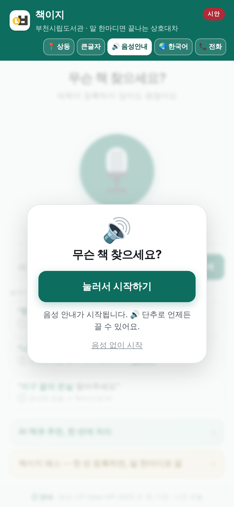

# 시연 웹: 기능 상세와 판별 이력

루트 README의 긴 버전입니다. 시연 웹(저장소 루트의 `index.html`)이 무엇을 구현했고 무엇이 시연인지, 판마다 무엇이 바뀌었는지 전부 적어 둡니다.
현재 판 **v1.12.16**(2026. 10. 28., 캐시 v42). 다섯 단계 흐름과 바로 열기 주소는 [루트 README](../README.md). v1.10부터의 판별 상세는 `docs/변경내역_시연웹_v1.10.txt`~`v1.12.16.txt`와 [루트 CHANGELOG](../CHANGELOG.md)에 있습니다.

## 무엇을 하나: 다섯 단계

1. **말하기**: 마이크를 누르고 일상어로 말한다. 정확한 서명이 아니어도 된다.
2. **도서 확정**: 발화에서 서지 단서를 추출해 정보나루 서지와 대조, ISBN 단위로 확정하고 근거를 화면에 표시한다.
3. **3단계 탐색**: 자주 가는 도서관 → 관내 16개관 → 전국 순으로 소장·대출 상태를 찾는다. 자주 가는 도서관에 있으면 신청 대신 서가 방문을 안내한다.
4. **규정 판정**: 수령관 비치 등 소장·대출 상태로 갈래(바로 이용·관내 상호대차·예약·책바다)를 정하고 사유를 보여준다. 회원 한도·연체처럼 회원 정보가 필요한 규정은 창구 확인으로 남긴다(규정 7종 판정은 상담 비서 서버의 몫).
5. **신청 안내**: 수령 도서관·예상 소요가 채워진 신청 요약을 확인 한 번으로 접수하는 흐름을 시연한다.

  

그림은 2026. 10. 27. 다시 찍은 화면(v1.12.13: 첫 화면 입력 칸 예시 「한강 소년이 온다」, 긴줄표 대신 쌍점. 결과·확인 시트는 v1.12.9부터 같음, v1.12.11은 시작 화면 배경의 흐림만 뺌). 확인 시트의 소요·수령 기한은 누리집 규정(10. 18. 반영), 윗줄은 「시연이라 실제로 접수되지는 않아요」

## 구현 기능

**기본 흐름**
- 음성 입력·안내 (브라우저 내장 Web Speech, 별도 서버 없음)
- **음성 안내 시작 화면**(v1.9): 첫 화면의 「🔊 눌러서 시작하기」를 누르면 환영 인사부터 읽는다(「음성 없이 시작」·헤더 🔊 단추로 끌 수 있음).
- **음성 안내와 화면 전환의 동기화**: 안내 문장이 끝나야 다음 장면으로 넘어가므로 듣는 속도로 절차를 따라올 수 있다. 음성을 끄면 기존 속도로 동작한다.
- 설치형 웹(PWA): 홈 화면 설치, 방문 후 오프라인 열람
- 📷 **바코드 검색**(v1.5): 책 뒤표지의 ISBN 바코드를 찍으면 소장 탐색으로 이어진다(BarcodeDetector 지원 기기에서만 단추 표시).

**모두에게: 접근성**
- 10개 언어 음성 인식·안내 전환 (한국어·영어·중국어·일본어·베트남어·태국어·러시아어·몽골어·우즈베크어·인도네시아어). 예시 도서는 언어마다 **그 언어 번역판 제목**으로 말하면 알아듣는다(『소년이 온다』 = Human Acts · 少年来了 · 少年が来る · Bản chất của người · Человеческие поступки · Хөвгүүн ирлээ · Mata Malam / 번역판이 없는 태국어·우즈베크어는 저자 이름과 영어 제목, 『지구 끝의 온실』은 뜻으로 옮긴 제목). 인식기가 낸 후보 3개를 모두 대조하고, 마이크 안내문도 그 언어로 나온다.
- 큰글자 모드, 검색 결과·신청 안내 음성 낭독(TTS)
- **전화 한 통 모드(통화 흐름 시연)**: 헤더의 📞 단추. 스마트폰·홈페이지를 못 다루는 이용자가 대표번호로 걸었을 때의 대화(인사 → 책 말하기 → 등록 번호 확인 → 판정 낭독 → 예/아니오 → 접수 → 「책이지가 대신 한 일」)를 목소리만으로 끝까지 재현한다. 판정·분기는 앱과 같은 논리를 쓰고, 마이크가 없으면 단추·입력으로 답할 수 있다. 전화로는 무료·취소 가능한 일(조회·관내 신청·예약)만 대신하고, 책바다(실비)는 안내로 넘긴다.
- **음성으로 확인**(v1.5): 음성 안내가 켜져 있으면(v1.7부터 기본 켜짐) 신청 확인 시트에서 「네/아니오」로 답해 손 대지 않고 접수까지.
- **언어별 음성 인식 지원 표시**(v1.8): 언어 선택 화면에서 이 기기의 브라우저가 각 언어의 음성 인식을 지원하는지 🎙/⌨로 표시(조회 API가 있는 브라우저에서만).

**기억과 위임: 편의**
- **자주 가는 도서관 선택**(v1.5): 헤더 단추 줄 맨 앞의 📍 단추를 누르면 16개관 중 고를 수 있고, 수령관·판정·예시 결과·문구가 전부 그 도서관 기준으로 다시 계산되며 새로고침 뒤에도 유지된다(규정 엔진이 상동 전용이 아님을 보이는 장치). 실제 서비스에서는 회원 정보의 주 이용 도서관이 이 자리를 채운다(시연에서는 손으로 고른다).
- **책이지 패스**(사전 위임) 시연: 도서관·기기·범위(관내 무료 상호대차만·월 3권·등록된 기기)를 한 번 정해 두면, 그 뒤로는 말 한마디로 접수까지 끝난다. 범위 안 신청은 확인 시트를 건너뛰고 바로 접수, 결과는 매번 통지, 접수 상태에서는 즉시 취소, 해지는 언제든. 범위 밖(책바다 실비·한도 초과)은 전처럼 확인 한 번을 거친다. 이달의 추천은 AI 책큐의 일이고 패스와는 별개다. **위임 범위를 화면뿐 아니라 음성으로도 고지한다.**
- AI 책큐 연계 시연: 추천 도서 일괄 확인·예약 흐름 (시작·계획 단계 음성 안내 포함)

**안전: 기기 안에서**
- **등록된 기기(패스키) 체험**(v1.5, ⓘ 안내에서 켜는 선택 기능): 켜 두면 첫 신청 때 지문·얼굴로 이 기기를 등록하고, 이후 무료 신청은 바로, 「책이지 패스」 위임 생성은 생체인증을 한 번 더 거친다. 서버 없이 기기 안(WebAuthn 플랫폼 인증기)에서만 동작하며 확인 시트에는 회원번호를 표시하지 않는다.
- **기기 내 음성 인식**(v1.5): 안드로이드 크롬 139+ 등 지원 기기에서는 음성이 기기 안에서 글자로 바뀐다(`processLocally`).
- **WebMCP 도구 등록**(v1.5): `navigator.modelContext`를 지원하는 브라우저에서는 `search_item`·`check_availability`·`request_service` 3종을 브라우저 AI에게 도구로 내놓는다. 신청 도구는 이용자 확인 없이는 거부(consequentialHint).

## 정직 고지: 전체 표 (무엇이 진짜이고 무엇이 시연인가)

| 구성요소 | 상태 |
|---|---|
| 화면·음성·다국어·판정 흐름 | **진짜**: 브라우저에서 전부 동작 |
| 소장·대출 데이터 | **실측값 고정 탑재**: 정보나루 Open API로 2026. 8. 18. 부천 16개관 × 도서 4종 = 64건 전수 조회 |
| 상호대차 신청 | **시연**: 실제 접수되지 않음 (도서관리시스템 연동은 운영 단계의 몫) · 확인 시트·완료 화면·완료 음성에 시연이라고 밝힘(v1.12.7) · 책바다 안내는 문자를 실제로 보내지 않는다고 밝히고, AI 책큐 완료 음성에도 시연 문장(v1.12.8) |
| 자주 가는 도서관에 있을 때 | **신청 없음: 방문 안내로 끝** · 규정상 신청이 되지 않으므로 접수 흐름을 타지 않고, 서가 자료를 대출대에 준비(보관)해 두는 식의 **없는 서비스를 흉내 내지 않는다**(전화 모드와 같은 판정) |
| 책이지 패스 | **사전 위임의 흐름은 진짜, 위임 기록·통지는 시연**: 등록 뒤 관내 무료 상호대차는 확인 없이 접수되고(시연) 한도·범위 밖은 확인으로 되돌아간다. 위임장 보존·실제 통지는 운영 단계 |
| 전화 한 통 모드 | **대화 흐름은 진짜, 전화망은 시연**: 실제 전화는 걸리지 않으며, 회선 연결은 통신 사업자 연동(AI 콜센터 API 또는 070 회선+음성 서버)이 필요한 운영 단계 과제 · 예시 책(③)은 답 앞에 「예시 장면입니다」(v1.12.8) |
| 대출 상태의 시점 | 정보나루 데이터는 **조회일 전일 기준**: 화면에 상시 고지 · 바로 이용 음성과 전화 한 통 모드는 그 답이 쓴 자료의 조회일을 말함(v1.12.7) · 결과 요약·갈래 설명·전화 답에서 「지금」을 빼고 「조회일 기준」, 방문 안내 화면·음성도 그 조회일을 말함(v1.12.8) |
| 등록된 기기(패스키) | **기기 안에서는 진짜, 서버 검증은 시연**: 생체인증은 실제로 뜨지만 회원 계정과 연결된 서버가 없다. **기본은 꺼짐**: ⓘ 안내에서 켠 경우에만 첫 신청 때 등록 창이 뜬다 |
| 바코드·기기 내 인식·WebMCP | **지원 기기·브라우저에서만 켜짐**: 미지원 환경에서는 단추·표시가 숨겨진다 |
| 외국어 음성 인식 | **브라우저·기기의 인식 언어 범위에 달려 있다**: 안드로이드 크롬은 10개 언어 대부분을, 아이폰 사파리는 Siri 받아쓰기가 되는 언어만 인식한다. 지원되지 않는 언어는 「이 기기는 ○○어 음성 인식을 지원하지 않아요」로 알리고 글자 입력으로 안내한다. 번역은 시연 웹이 하지 않는다. 운영 단계에서는 DeepL 공식 MCP 서버 같은 번역 도구를 에이전트 옆에 붙인다(설계도 08절) |
| 음성 인식 언어 | **기기 브라우저가 지원하는 언어만**: 화면 안내·낭독은 10개 언어이지만 음성 인식은 기기·브라우저 지원 범위에 따른다. 언어 선택 화면에 이 기기의 지원 여부를 표시(조회가 안 되는 기기는 표시 없음) |

## 파일 구성

    index.html            화면·논리 전부 (단일 파일)
    sw.js                 서비스워커 — 오프라인·최신 화면 유지
    manifest.webmanifest  설치형 웹 정보(이름·아이콘·색)
    icon-192.png / icon-512.png  앱 아이콘
    mcp.html / console.html      확산 모델 설계도·도구 호출 콘솔
    docs/변경내역_시연웹_v1.9r11.txt  v1.9 r11 변경 내역 원문
    docs/변경내역_시연웹_v1.10.txt ~ v1.12.8.txt  v1.10 이후 판별 변경 내역 원문
    data/holdings-today.json  매일 갱신 조회분(깃허브 액션이 새벽에 커밋)

## 판별 이력

| 판 | 시기 | 한 줄 요약 |
|---|---|---|
| v1.0 | 2026. 8. | 최초 공개: 음성 검색·3단계 탐색·규정 판정·신청 흐름, 10개 언어, 큰글자·낭독, PWA |
| v1.1 | 2026. 8. | 음성 안내와 화면 전환 동기화 · AI 책큐/책이지 패스 음성 안내 |
| v1.2 | 2026. 9. | 첫 화면을 한 화면에 · **실제 운영 규정 반영**(예약 분기 · 책바다는 안내 · 수령 기한·미수령 제한 고지 · 취소 시점) |
| v1.3 | 2026. 9. 4. | **전화 한 통 모드** · 설계도·콘솔을 참조 서버 v0.3 기준으로 개정 |
| v1.3.1 | 2026. 9. 6. | 마이크 단추 복원·키움 · 아이폰 사파리 첫 허용 뒤 마이크 문제 수정 · 전화 안내 10개 언어 |
| v1.5 | 2026. 9. 10. | 📍 자주 가는 도서관 · 📷 바코드 · 등록된 기기(패스키) · 「네/아니오」 음성 확인 · 기기 내 인식 · WebMCP · 10개 언어 음성 인식 보강 · 설계도 08절 「표준과의 접점」 |
| v1.6 | 2026. 9. 15. | **정직성 수정**: 있는 도서관에서는 방문 안내로 끝 · 책이지 패스를 「사전 위임」으로 재정의 |
| v1.7 | 2026. 9. 19. | 음성 인식 관리자(SRM) · 설치 배너 끔 · 음성 안내 기본 켜짐 · 자동 시험 66+17건 |
| v1.8 | 2026. 10. 1. | 언어별 음성 인식 지원 표시 |
| v1.9 | 2026. 10. 2. | **음성 안내 시작 화면** · 낭독 안정화 · 캐시 v23 |
| (문서) | 2026. 10. 13. | README 전면 개정: 화면 사진 · 걸어온 길 (앱 동작 변화 없음) |
| v1.10 | 2026. 10. 14. | 정보나루 중계 연결 자리(`RELAY`): 주소를 넣으면 실데이터, 3초 안에 답이 없으면 8/18 실측으로 자동 복귀 · 캐시 v24 |
| v1.11 | 2026. 10. 15. | 매일 갱신 파일(`data/holdings-today.json`, 2일 이내) 읽기 · 조회일 표기 통일 · 캐시 v25 |
| v1.12 | 2026. 10. 16. | 화면 정리(카드 2장을 글자 줄로, 도서관코드·기술 용어 행 숨김) · 「공식 누리집에서 이 책 보기 · 신청」 링크 · 캐시 v26 |
| v1.12.1 | 2026. 10. 16. | 예시 단추는 8/18 장면 고정, 직접 찾으면 오늘 자료 · ③ 「예시」 배지·출처 줄 정정 · 캐시 v27 |
| v1.12.2 | 2026. 10. 16. | **중계 연결**(Cloudflare Workers 첫 배포): 오늘 새벽 매일 갱신 파일에 있는 책은 그 파일, 아니면 중계(3초) → 2일 이내 파일 → 8/18 · 캐시 v28 |
| v1.12.3 | 2026. 10. 17. | 완료 화면에 시연 표시(10개 언어) · 「관내 상호대차로」 받침 맞춤 · 바닥글 날짜 자동(매일 갱신 파일) · 큰글자 모드 검색 단추 한 줄(리허설 지적, 담당자 승인) · 캐시 v29 |
| v1.12.4 | 2026. 10. 18. | 상호대차 규정 문구를 부천시립도서관 누리집 안내(2026. 8. 10. 수정판)와 맞춤: 소요 「2~3일」 → 「평일 다음 날」(금·토 신청은 월·화), 수령 「도착일 포함 3일」, 미수령 「10일간 신청 제한(예시 규정)」·음성 「열흘간」 → 「자동 반납 · 7일간 신청 제한」, 전화 모드 문장 · 10개 언어 · 캐시 v30 |
| v1.12.5 | 2026. 10. 18. | 「공식 누리집에서 이 책 보기 · 신청」 링크를 제목 검색에서 **ISBN 검색**으로: 그 판본 화면까지 바로 열림(담당자가 자료검색에서 ISBN 검색 확인) · ISBN이 없을 때만 제목 검색 · 화면 글자는 그대로 · 캐시 v31 |
| v1.12.6 | 2026. 10. 19. | **심사 기간 고정 자료**: 11. 8. 18시 동결 뒤 새벽 갱신이 멈추므로 11. 8. 이후 새벽 자료를 11. 26.까지 오늘 자료처럼 씀(시연 도서는 중계·정보나루 호출 0, 조회일은 「11. 8.」 그대로, 평소 규칙 그대로, 결선 뒤 지움) · 큰글자 모드에서 마이크 단추·둘레 고리를 보통 크기로(고리가 안내 글을 가로지르던 것, 10/17 고침안·10/19 승인) · 캐시 v32 |
| v1.12.7 | 2026. 10. 26. | **정직 표시 문구**(담당자 승인 안 A): 완료 음성 끝 시연 문장 · 예약 갈래 「반납될 때 상호대차로 바꿔 신청할 수 있음」 · 확인 시트 「시연이라 실제로 접수되지는 않아요」 · 예시 장면 음성 앞머리 · 바로 이용 음성·전화 모드에 그 답이 쓴 자료의 조회일 · 「이해했습니다」 줄은 들은 말 그대로 · 못 찾음 「예시 5권만」 · 예약 갈래 배지 · 「신청 규정 확인(한도·연체는 창구에서)」 · 접수번호 DEMO · 전화 모드 「도착한 날을 포함해 3일」 · 로/으로 · 회색 글자 대비 · 2단계 「무슨 책인지 맞춰 보기」(10개 언어) · 맞추기·판정·자료 흐름 그대로 · 캐시 v33 |
| v1.12.8 | 2026. 10. 26. | **남은 정직 표시 문구**(담당자 승인): 결과 요약 「지금 있습니다」 → 「있습니다(조회일 기준 대출 가능)」, 갈래 설명·전화 답은 「지금」만 뺌 · 관내 상호대차 요약 「대출 중이지만」(받을 도서관에 없으면 「없지만」) · 방문 안내 화면·음성에 그 판정이 쓴 자료의 조회일, 상태 칸 「대출 가능(조회일 기준)」 · 책바다는 문자를 보낸다고 하지 않음(확인 시트·완료 화면·완료 음성·전화 모드) · AI 책큐 완료 음성 끝 시연 문장 · 전화 모드 예시 책 「예시 장면입니다」(10개 언어) · 맞추기·판정·자료 흐름 그대로 · 캐시 v34 |
| v1.12.9 | 2026. 10. 27. | **담당자 승인 두 가지**: 전화 모드 두 번째 답(관내 상호대차)도 받을 도서관에 그 책이 없으면 「○○도서관에는 없지만」(결과 요약과 같은 기준, 10개 언어, 한국어는 「지금」도 뺌) · 한국어 결과 음성에서만 요약의 「(조회일 기준 대출 가능)」을 뺌(바로 뒤 「○월 ○일 조회 자료로는 대출 가능합니다」와 겹침, 화면 글은 그대로) · 캐시 v35 |
| v1.12.10 | 2026. 10. 27. | **애니메이션을 멈춘 기기의 흰 화면**(갤럭시 제보): 화면이 「투명 → 보임」 애니메이션에 기대고 있어 기기가 애니메이션을 멈추면 초록 머리 띠 아래가 흰 화면으로 남던 것. 0.9초·2.5초 뒤 화면이 투명하면 애니메이션을 끄고(html.noanim) 원래 모습으로, 「동작 줄이기」 기기는 처음부터 애니메이션 없이, 자바스크립트가 꺼져도 첫 화면이 보이게 · 평소에는 그대로 · 캐시 v36 |
| v1.12.11 | 2026. 10. 27. | **조기 마감 · 시작 안전장치 · 갤럭시 대비**(담당자 결정·승인): 동결을 10. 30. 18시로 앞당겨 심사 기간 고정 자료의 시작일도 10. 30.(서버·원격 상담 비서·운영 점검과 같은 값) · 스크립트가 끝까지 못 돌면 흰 화면 대신 안내 띠(크롬·사파리로 열기, 그림으로 둘러보기, 점검), 자바스크립트가 꺼지면 noscript 안내 · 갤럭시 캡처(머리 띠도 없이 배경색만)에 대비해 시작 화면 흐림 효과 뺌, 화면 틀이 줄지 않게, 불러온 뒤 화면 틀이 안 보이면 단순 배치로 다시 놓고 그래도 안 보이면 안내 띠 · 예약 갈래 설명·요약·전화 답에서 「지금」 뺌 · 전화 마지막 답(바로 이용·관내 상호대차·예약) 끝에 확인 시트와 같은 시연 문장을 붙임 · 캐시 v37 |
| v1.12.12 | 2026. 10. 27. | **간단 모드**(갤럭시 「탭이 중지된 상태입니다」 제보): 시작할 때 「시작함」을 적고 끝까지 열리거나 정상으로 닫히면 「열림」으로 바꿈, 다음에 열 때 「시작함」이 남아 있으면 하루 동안 간단 모드(음성 안내·음성 인식·바코드·생체 인증·서비스워커·WebMCP·애니메이션을 빼고 검색 → 결과 → 신청 확인만, 첫 화면 맨 위에 안내와 「보통 모드로 열기」) · 주소 ?safe=1·?safe=0 · 기기 내 음성 인식 조회·WebMCP는 구글 크롬에서만 · 광고 차단이 단순 배치로도 화면 틀을 숨기면 틀의 이름을 바꿔 피함 · 10초 안에 다 받지 못하면 연결 알림(다시 불러오기 · 휴대폰 데이터로 · 그림으로 둘러보기) · 평소 화면은 그대로 · 캐시 v38 |
| **v1.12.16** | 2026. 10. 28. | **접근성 점검 반영**(담당자 14:59): axe-core 4.10, WCAG 2.2 A·AA 위반 0건(점검 전에도 0건), 권장 사항 3종 고침. 머리 영역 role=banner, 본문 role=main, 판정 화면 책 제목 h2(머리말 단계), 신청 확인 시트 role=dialog·aria-modal·aria-labelledby. 화면 모양 그대로. 캐시 v42 |
| **v1.12.15** | 2026. 10. 28. | **예시 단추 순서**(담당자 13:15): ① 나미야 잡화점의 기적(관내 상호대차) ② 한강 소년이 온다(바로 이용). 판정은 8. 18. 실측 그대로, 문구는 단추의 장면 번호(data-case)를 따름. 10개 언어·전화 모드 같은 순서. 캐시 v41 |
| **v1.12.14** | 2026. 10. 27. | **기관 표기**(담당자 17:58): 화면 아래 「성격」 칸의 「부천시립도서관 상동도서관」을 「부천시립상동도서관」으로. 동작은 그대로. 캐시 v40 |
| **v1.12.13** | 2026. 10. 27. | **검색 예시 · 전화 모드 자료 · 긴줄표**(담당자 요청 16:10·15:56·15:55): 입력 칸 예시(10개 언어)와 「예시 5권만」 안내의 첫 책을 소년이 온다로. 전화 모드도 화면과 같은 규칙(예시 단추는 8. 18. 실측 장면, 직접 말하거나 입력하면 오늘 새벽 자료와 그 조회일). WebMCP `check_availability`도 오늘 자료와 조회일(asof). 화면·음성 글의 긴줄표 196곳을 쌍점·괄호·문장으로(10개 언어, 낱말은 그대로). 캐시 v39 |

판별 상세 변경 내역 (펼치기)

| 버전 | 시기 | 내용 |
|---|---|---|
| v1.9 | 2026. 10. 2. | **음성 안내 시작 화면·낭독 안정화**: ① 첫 화면에 「🔊 눌러서 시작하기」를 두고, 누르면 환영 인사(「무슨 책 찾으세요? 마이크 단추를 누르고 책 제목을 말씀해 주세요…」)부터 읽는다(10개 언어). 브라우저(아이폰 사파리·크롬)는 이용자가 한 번 누르기 전에는 소리를 낼 수 없으므로, 그 첫 터치 안에서 읽는 환영 인사가 곧 음성 합성 깨우기가 된다. 「음성 없이 시작」을 누르면 음성 안내를 끄고 기억 ② 화면에 들어가자마자 예시·마이크를 눌렀을 때 안내 음성이 나오지 않던 원인 수정: v1.7의 깨우기가 touchstart·pointerdown(브라우저가 이용자 동작으로 쳐 주지 않는 사건)에서만 시도됐고 마이크 단추는 건너뛰어, 깨어나지 않은 채 읽으려다 조용히 버려지던 것. 이제 click·키 입력(이용자 동작으로 인정되는 사건)에서 깨우고, 깨우기가 거부되면(not-allowed) 다음 터치에서 다시 시도 ③ 낭독 안정화: cancel() 직후 speak()가 묻히던 크롬(안드로이드) 문제(말하는 중일 때만 끊고 90ms 뒤 읽기), 목소리 목록을 미리 불러 현재 언어 목소리 지정, 멈춤 상태면 resume(), utterance 참조 유지 ④ ⓘ 안내에 「음성 안내」 행 추가 · 캐시 v23 |
| v1.8 | 2026. 10. 1. | **언어별 음성 인식 지원 표시**: 언어 선택 화면에서 이 기기의 브라우저가 각 언어의 음성 인식을 지원하는지 조회해 🎙(음성 가능)/⌨(글자 입력만)로 표시(크롬 139+ 등 조회 API가 있는 브라우저에서만, 그 밖에는 표시 없음 · 아이폰 사파리는 몽골어·우즈베크어를 글자 입력으로 안내), 지원하지 않는 언어를 고르면 글자 입력 안내를 바로 띄움 · 캐시 v22 |
| v1.7 | 2026. 9. 19. | **음성 인식 보강·설정 기본값 변경**: ① 음성 인식 관리자(SRM) 도입: 마이크·확인 시트·전화 모드가 인식기를 하나만 쓰고, 안내 음성이 끝난 뒤에 듣기 시작(낭독을 마이크가 주워 듣거나 시작이 조용히 실패하던 원인 제거), 「듣고 있어요」 화면에 말한 내용이 글자로 바로 보임(중간 결과), 확정 신호 없이 끝나는 기기(아이폰 사파리)는 마지막 중간 결과로 검색, 결과 없이 오래 열려 있으면 자동 종료, 무음은 한 번 더 듣기(확인 시트·전화), 인터넷 오류 안내 추가(10개 언어), 전화 모드 「🎙 다시 듣기」 단추 ② 「휴대폰에 설치할 수 있어요」 배너 표시 안 함(설치 기능 자체는 유지) ③ 음성 안내 기본 켜짐(끄면 기억): 첫 터치에서 음성 합성을 깨워 아이폰·크롬에서도 첫 안내부터 낭독 · 캐시 v21 |
| v1.6 | 2026. 9. 15. | **정직성 수정 두 가지**: ① 자주 가는 도서관에 있을 때 「대출대 보관 요청」으로 끝나던 흐름을 없앰: 규정상 신청이 되지 않는 경우이므로 확인 시트 없이 **방문 안내**(있는 도서관·대출 상태·지도 길찾기)로 끝나고, 「대신 한 일」은 「규정상 신청 불필요 판정 → 방문 안내」(전화 모드와 동일). AI 책큐 일괄 처리의 같은 문구도 「바로 이용(신청 없음)」으로 ② **책이지 패스 재정의**: 「매달 추천 3권 자동 준비」(구독) 화면을 삭제하고, 「한 번 등록하면 말 한마디로 끝」(사전 위임)으로: 등록 뒤 관내 무료 상호대차 판정이면 확인 시트 없이 바로 접수 + 완료 화면에 「패스로 확인 없이 접수 · 즉시 취소」 표시, 월 3권 한도·책바다 실비는 확인으로 복귀, 상태 패널(범위·이번 달 사용·해지). 10개 언어 전부 · 캐시 v20 |
| v1.5 | 2026. 9. 10. | **편의·안전 보강**: 📍 자주 가는 도서관 단추(헤더 단추 줄, 16개관, 판정·문구 전부 재계산, 새로고침 유지) · 📷 바코드 검색(지원 기기) · 등록된 기기(패스키) 시연: 첫 신청 때 기기 등록, 무료 신청은 바로, 위임 생성은 생체인증 한 번 더 · 확인 시트에서 회원번호 미표시 · 음성 안내 중 「네/아니오」로 접수 · 기기 내 음성 인식(지원 기기) · WebMCP 도구 3종 등록(지원 브라우저) · ⓘ 안내에 4행 추가 · **10개 언어 음성 인식 보강**(예시 제목을 각 언어 번역판 제목으로, 인식 후보 3개 대조, 예시 제목 부분 일치 매칭, 마이크 안내문 10개 언어, 언어 미지원 안내) · 패스키 체험은 ⓘ에서 켜는 선택 기능으로(기본 꺼짐) · 아이폰 입력창 자동 확대 방지(16px) · **홈 화면 설치판(standalone) 안전 영역**: 상태 표시줄·홈 표시선 자리를 비움(헤더·푸터·시트·전화 화면) · 헤더 단추 줄 넘침 판정 수정(오른쪽 정렬이라 왼쪽으로 넘치던 경우, 영어 등 긴 이름) · 「기기 안에서 인식」 표시가 미지원 기기에서도 보이던 문제 수정 · 캐시 v19 · **설계도 08절 「표준과의 접점」 추가**(WebMCP·A2A·ISO 18626·패스키·기기 내 인식·브라우저 내장 AI·범정부 AI 공통기반·모바일 신분증) · 설계도 08절 표 열 너비 고정(휴대폰에서 표가 찌그러지던 문제, 9/14) |
| v1.3.1 | 2026. 9. | 음성 단추를 캐릭터에서 마이크 그림(SVG, 기기마다 같은 모양)으로 되돌리고 키움(124px) · 부제 「제목이 정확하지 않아도 괜찮아요」를 설치 배너·마이크 오류 상태에서도 표시(낮은 화면 제외) · **아이폰 사파리 첫 허용 뒤 마이크가 안 켜지던 문제 수정**(이전 인식 세션 정리, 재시도 안내) · 못 알아들은 제목은 1번 예시로 넘기지 않고 현재 언어로 안내 · 전화 안내 시트와 헤더 단추(큰글자·음성·전화)도 10개 언어 · 큰글자 모드가 통화 화면·안내 시트에도 적용 · 캐시 v12 |
| v1.3 | 2026. 9. | **전화 한 통 모드 신설**: 헤더 📞 단추 → 안내 시트(본인 확인·하는 일·안 하는 일·현재 상태) → 통화 흐름 시연(10개 언어, 마이크 없을 때 단추·입력 대체) · 좁은 화면에서 헤더 단추 4개가 한 줄에 들어오도록 짧은 이름 · 캐시 v11 · **설계도(mcp.html)·콘솔(console.html)을 참조 서버 v0.3 기준으로 개정**: 도구 10종(신청 추적·취소 추가), 적합성 시험 33건, 규정 7종, 안전 원칙 9종, 예약 분기·책바다 안내, 재시도 중복 방지 시연 |
| v1.2.1 | 2026. 9. | 설치 배너가 떠 있어도 첫 화면이 한 화면에 들어오도록 화면 높이별 압축 단계 추가(780·720·700·620px) · 캐시 v10 |
| v1.2 | 2026. 9. | 첫 화면을 한 화면에 맞춤(스크롤 없음) · 헤더·푸터 고정 · 설명을 「ⓘ 안내」 시트로 옮기고 항목별 정렬 · 첫 문구를 질문형 한 줄로(10개 언어) · **실제 운영 규정 반영**: 관내 전부 대출 중이면 전국이 아니라 예약 분기, 책바다는 대행이 아닌 안내(별도 가입·사서 승인), 신청 확인에 수령 기한·미수령 제한 고지, 완료 화면에 취소 가능 시점과 「책이지가 대신 한 일」 표시 |
| v1.1 | 2026. 8. | 음성 안내와 화면 전환 동기화 · AI 책큐/책이지 패스 음성 안내 추가 · 아이폰 설치 안내 문구 개선(10개 언어) · 설치 배너 언어 전환 반영 |
| v1.0 | 2026. 8. | 최초 공개: 음성 검색·3단계 탐색·규정 판정·신청 흐름 시연, 10개 언어, 큰글자·음성 낭독, PWA 설치 |

